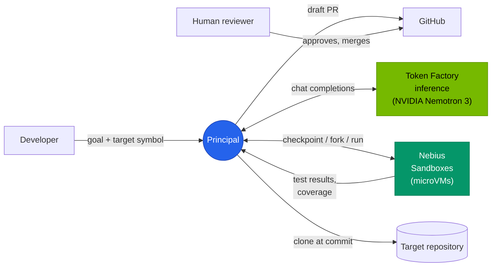
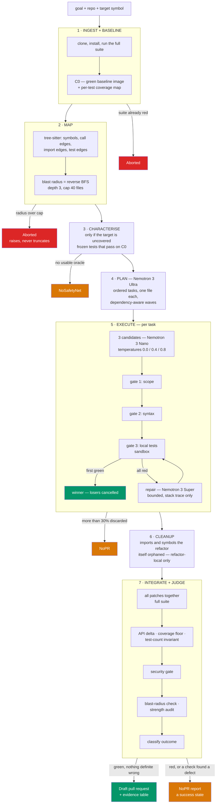
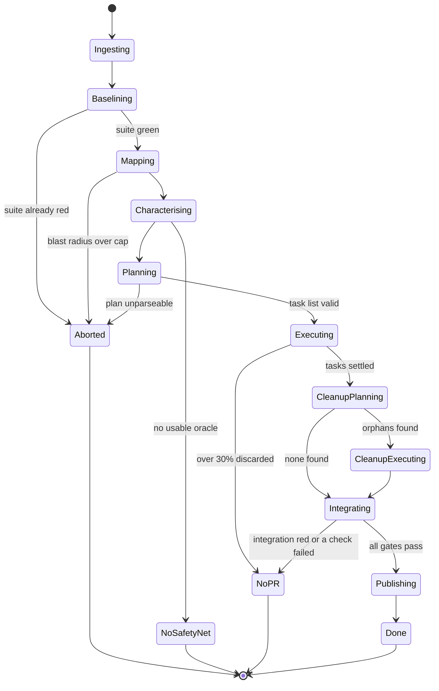

<div align="center">

# Principal

### Refactors that arrive **already verified**.

**An autonomous technical-debt remediation swarm. It rewrites a real repository across dozens of files, and it will not open a pull request unless the repository's own tests are green.**

[](https://github.com/BugHunterX2101/AMTDRS/actions/workflows/ci.yml)
[](LICENSE)


**[Live demo](https://amtdrs.onrender.com)** · **[Console](https://amtdrs.onrender.com/app/)** · **[Results](#results)** · **[Architecture](#architecture)** · **[Quickstart](#quickstart--no-credentials-needed)** · **[Verification](#verification)**

</div>

Built for the **[Nebius × NVIDIA Global AI Hackathon 2026](https://nebiusglobalaihackathon.devpost.com/)**, track **Coding and Agentic Engineering**.

---

## In 30 seconds

| | |
|---|---|
| **The problem** | AI writes a wide refactor in minutes. A human then spends hours reviewing forty edits to find the one that is wrong. **Generation is cheap; verification is the bottleneck.** |
| **The idea** | Replace *one careful attempt* with **many cheap parallel attempts and one hard gate**. Race several candidate patches inside private sandboxes, keep the first that passes the repository's real tests, and throw the rest away for free. |
| **The guarantee** | **Fail closed. No green test, no PR.** `NoPR` is a success state: "I tried, here is what I tried, I could not verify it, so I am not shipping it." |
| **What makes it different** | **No model in the accept path.** The decision is a `pytest` exit code from a real run in a real microVM, and an import contract enforced in CI stops the gate code from ever importing the model code. |
| **Honest by construction** | Every run is classified **VERIFIED / UNVERIFIED / FAILED / ERROR**. A green suite that never exercised the changed code is reported as *unverified*, not as success. |
| **Headline result** | On a fixture repository, 6 of 6 tasks verified and **9 of 9 call sites** migrated, on 19,855 tokens. On a repository with weak tests, a change whose tests all passed was **refused as unverified**. Each is one run, not a rate; see [Results](#results). |

| | |
|---|---|
| **Track** | **Coding and Agentic Engineering**: agents that write, run and test code in Nebius Sandboxes |
| **Runs on** | **Nebius Token Factory**, for both inference **and** Sandboxes |
| **Models** | **NVIDIA Nemotron 3**: Nano 30B-A3B · Super 120B-A12B · Ultra 550B-A55B |
| **Stack** | Python 3.11+ · FastAPI + SSE · SQLite · tree-sitter · React + Vite · MCP |
| **License** | **Apache 2.0** |
| **Checked** | 2026-10-26: 536 tests, `ruff` clean, 4 import contracts kept. CI on `fc58ec5` passed all 7 jobs on Ubuntu and Windows, Python 3.11 and 3.12 ([run 40287640175](https://github.com/BugHunterX2101/AMTDRS/actions/runs/40287640175)). The [CI badge](https://github.com/BugHunterX2101/AMTDRS/actions/workflows/ci.yml) is the live signal. |

---

## Contents

1. **Why**: [The problem](#the-problem) · [Why *wide* refactors](#why-wide-refactors-specifically) · [Where this sits in the market](#where-this-sits-in-the-market)
2. **What it does**: [How it works](#how-it-works), the gates and the four outcomes · [Results](#results)
3. **Use it**: [Quickstart](#quickstart--no-credentials-needed) · [Full setup](#full-setup--with-nebius-token-factory) · [Running it](#running-it), covering the CLI, API, dashboard, MCP server, benchmark and deploy
4. **Inside**: [Architecture](#architecture) · [Design decisions](#design-decisions-worth-reading-the-code-for) · [How NVIDIA models and Nebius services are used](#how-nvidia-models-and-nebius-services-are-used) · [What a run costs](#what-a-run-costs)
5. **Trust and reference**: [Repository structure](#repository-structure) · [Safety](#safety) · [What is *not* claimed](#what-is-not-claimed) · [Project provenance](#project-provenance) · [Verification](#verification) · [Documentation](#documentation) · [License](#license)

---

## The problem

The technical debt that costs real money has a specific shape:

> A signature change that touches **forty call sites across nine modules**, where being right in eight modules and wrong in the ninth is *worse than not starting*, because now a human must review a large diff to find the one mistake.

Deprecating a parameter, renaming a widely used internal API, threading a new context object through a call chain: these block framework upgrades and sit in a "modernisation" epic for quarters, because the diff is too wide to review confidently and too mechanical to be interesting. The cost sits in **review**, not in writing the patch.

- Technical debt is estimated at **21–40% of IT spending** by Deloitte's [2026 Global Technology Leadership Study](https://www.deloitte.com/us/en/insights/topics/technology-management/technical-debt-impact.html), which notes the range is hard to measure and has no standard benchmark.
- In the [2025 Stack Overflow Developer Survey](https://survey.stackoverflow.co/2025/), **84%** of respondents were using or planning to use AI tools, yet only **29%** said they trust them ([Stack Overflow, 2026](https://stackoverflow.blog/2026/02/18/closing-the-developer-ai-trust-gap/)), and **66%** named *"AI solutions that are almost right, but not quite"* as their top frustration.
- Google's [2025 DORA report](https://dora.dev/dora-report-2025/) calls AI **"an amplifier, magnifying an organization's existing strengths and weaknesses."**

**Generation is solved and cheap. Verification is unsolved and expensive, and it is now the constraint.** A tool that *sometimes* ships an unverified change is worth less than no tool, because it poisons every diff it produces with the possibility that this is one of the bad ones. `NoPR` turns an unbounded review task back into a bounded one.

## Why *wide* refactors specifically

[**SWE Atlas Refactoring**](https://labs.scale.com/leaderboard/sweatlas-refactoring) (Scale Labs) is the closest public proxy: **70 tasks** from **10 production repositories**, **6 languages**, **4 refactor types**: decomposition (29), interface evolution (20), extraction (14), relocation (7). Leaderboard read on 2026-10-21 and unchanged on 2026-10-26:

| Rank | System | Score |
|---:|---|---:|
| 1 | GPT 6 Astra (Codex) xHigh | **59.05** ±6.43 |
| 2 | Fable-5.1 (Claude Code) xHigh | 56.67 ±6.52 |
| 3 | Fable-5 (Claude Code) xHigh | 54.76 ±6.76 |
| 4 | Opus-4.7 (Claude Code) | 48.57 ±6.73 |
| 5 | Opus 4.8 (Claude Code) | 46.67 ±6.75 |
| 17 | Gemini-3-Flash (Mini-SWE-Agent) | 10.00 ±4.80 |

**The best system on the board solves fewer than six in ten.** A model that is right 59% of the time on a wide refactor is unusable if you ship its first answer, and very useful if you can generate several answers cheaply and let a test suite pick.

> **The thesis: the remaining gap is a *scaffolding* problem more than a *weights* problem.** Principal has **not** been run against SWE Atlas; the board is cited as evidence the problem is open. See [What is *not* claimed](#what-is-not-claimed).

## Where this sits in the market

Two mature categories each cover part of the problem. Neither covers the middle.

| | **Coding agents**<br>(Codex, Claude Code, Cursor, Devin) | **Deterministic mass refactoring**<br>([OpenRewrite](https://docs.openrewrite.org/) / [Moderne](https://moderne.ai/)) | **Principal** |
|---|---|---|---|
| Handles a *novel*, bespoke refactor | yes | no, needs a pre-written recipe | **yes** |
| Correctness signal | human review | AST transform correct by construction | **real test-suite exit code** |
| Will it ship something unverified? | yes, that is what review is for | no | **no, it fails closed** |
| Scales across many repositories | partially | **yes**, its whole design | one repository per job |
| Measured ceiling on wide refactors | top of SWE Atlas: **59.05** | n/a, not a model | not measured on SWE Atlas; **races several attempts** |

- **Coding agents** are general but unverified: they hand you the review problem.
- **OpenRewrite / Moderne** is the serious incumbent (Moderne raised a **$30M Series B, led by Acrew Capital, on 11 Feb 2025**, per [TechCrunch](https://techcrunch.com/2025/02/11/moderne-raises-30m-to-solve-technical-debt-across-complex-codebases/)): deterministic transforms are exceptionally safe but **require someone to write the recipe first**.
- **Principal takes the third position:** LLM generality for the diff, deterministic machinery for the decision. *The model proposes; a real test run in a real sandbox disposes.*

---

## How it works

A job, start to finish (the [pipeline diagram](#the-verification-pipeline) shows the same sequence with its exits):

1. **Baseline.** Clone the repository at a commit inside a sandbox, install it and run the whole suite. A green suite becomes the checkpoint image `C0`, which everything later forks from, with a per-test coverage map. A red suite aborts the job.
2. **Map.** tree-sitter builds a code graph. The **blast radius** is everything that can reach the target through call and import edges: a reverse search to depth 3, at most 40 files. Over that the job aborts rather than truncating.
3. **Characterise**, only if the target has no tests: frozen tests that pass on `C0`.
4. **Plan.** Nemotron 3 Ultra splits the goal into ordered **tasks**, one file each, with consumers first when the change is breaking.
5. **Execute.** Each task races candidate patches through gates 1 to 3 (below). If more than 30% of the tasks end discarded, the job stops in `NoPR`.
6. **Clean up** the imports and symbols the refactor itself orphaned.
7. **Integrate and judge.** The verified patches are applied together, gates 4, 5, 4b and 4c run once, and the run is classified (see the four outcomes below).

Inside step 5, for each task Principal:

1. generates **several independent candidate patches in parallel** (3 per task, temperatures **0.0 / 0.4 / 0.8**);
2. pushes each through **gates 1 to 3**, cheapest first;
3. **races them**: the first to go green wins, and if all fail a Super model gets a bounded number of repairs;
4. **cancels the losers**, whose failure costs nothing because it happened inside a private sandbox fork nobody ever sees.

**No scoring function and no model in the accept path:** the decision is a `pytest` exit code, not a language model's opinion of a diff. **Losing is free:** a failed candidate corrupts only its own fork.

### The gates

Gates 1 to 3 run on every candidate, cheapest first, so most bad candidates die *before* they touch a sandbox: a candidate rejected by gate 1 or 2 spent one cheap completion and zero sandbox operations, which is what makes generous fan-out affordable. Gates 4, 5, 4b and 4c run once per job, on the combined result, in the order listed.

| Gate | What it proves | Runs where | Cost |
|---|---|---|---|
| **1 · Scope** (`gates/scope.py`) | the patch touches only its one target file, never a test, a manifest or a lockfile | local | microseconds |
| **2 · Syntax** (`gates/syntax.py`) | every changed file still parses (tree-sitter) | local | milliseconds |
| **3 · Local tests** (`gates/tests.py`) | the tests that actually cover the changed lines pass | Nebius sandbox | seconds |
| **4 · Integration + behaviour** (`gates/behaviour.py`) | all accepted patches pass **together**; the public API delta matches the plan's *declared* removals; **coverage may not fall**; **test count may not shrink** | sandbox, once | seconds |
| **5 · Security** (`gates/security.py`) | the patch introduces **no new** security finding: *differential*, rule-based, deterministic | local | milliseconds |
| **4b · Blast-radius check** (`gates/impact.py`) | what the patch changed matches what the graph says it should have reached | local + sandbox | seconds |
| **4c · Strength audit** (`gates/strength.py`) | would the passing tests *notice* a mistake? Injects deliberate faults into only the changed lines and re-runs the covering tests | sandbox | seconds |

None of these gates calls a model, and the import contract in [Architecture](#architecture) makes that a machine-checked fact rather than a promise.

### What a finished run tells you

Green tests are necessary, not sufficient. Every finished run is classified into **exactly one** outcome by a pure function of its stored record (`principal/outcome.py`: no database read, no model call, no clock):

| Outcome | Meaning | Offered |
|---|---|---|
| **VERIFIED** | the tests pass and every check that ran came back clean | draft PR |
| **UNVERIFIED** | no definite defect, but something is still open: a call site no test exercises, tests that missed injected faults, a partial migration, or nothing could be checked | draft PR flagged for a human, or nothing |
| **FAILED** | a check found a **definite** defect (incompatible with code outside the changed files, patches fail together, or a new security finding) | nothing |
| **ERROR** | the **platform** failed. It says nothing about the patch and is never counted against it | nothing |

- The **strength audit is a measurement, not a proof**: a run that could not be measured says so instead of defaulting to a flattering score.
- Every finished run has an **evidence bundle** (`GET /jobs/{id}/evidence.zip`): the verdict, each gate's result, every attempt's diff and test log with **SHA-256** hashes (a file changed after the run is flagged), and the command that reproduces the run.

## Results

Everything below ran on the **real Nemotron models and the real Nebius sandbox**. Runs are in the order they were made. Each row is **one run, not a rate**, and Principal's own classifier, not a person, assigned every outcome. Terms such as the strength audit, injected faults and the 30% cap are defined in [How it works](#how-it-works).

| Run | Repository and goal | Outcome | What decided it |
|---|---|---|---|
| **1** | weak-tests repository: clean up `pricing.calc_total` | **UNVERIFIED** | Both tasks verified and the tests pass, yet the strength audit caught **0 of 1** injected faults and `src/reports.py` reaches the target through `getattr`, which no test runs. Principal produced a change and **refused to call it verified**. |
| **2** | same, model cache off | UNVERIFIED | Every candidate and repair failed; no change produced, repository untouched. The same job is not deterministic. |
| **3** | `mini_repo`: make `create()`'s `ttl` keyword-only and update every call site | UNVERIFIED, `NoPR` | 2 of 6 tasks discarded, over the 30% cap |
| **4** | `mini_repo`, after the diff-parser fix | UNVERIFIED | 5 of 7 verified, but the task that changes the definition of `create()` was discarded, so `ttl` was not keyword-only |
| **5** | `mini_repo`, dependency-aware verification | UNVERIFIED, `NoPR` | 4 of 6 verified; one consumer discarded after a blank-line mismatch, so the definition's task failed red |
| **6** | `mini_repo`, same goal, after the blank-line fix | **VERIFIED** | 6 of 6 tasks verified by a first-round Nano candidate. **9 of 9 call sites** changed, 0 unexpected files, both dynamic paths in `src/registry.py` exercised by tests. 7 of 9 injected faults detected (78%, floor 60%). **19,855 tokens.** |
| **Hosted** | the `mini_repo` goal again, started from the public URL | **VERIFIED** | 6 of 6 tasks, 30,644 tokens, $0.0116 of sandbox cost, injected-fault score 78% |

- **The token ledger reconciles.** In runs 2 to 6, tokens charged equal tokens attributed to a role and model, with none unattributed: 26,711 · 58,409 · 69,748 · 56,261 · 19,855.
- **The runs before the first VERIFIED result lost tasks for specific, fixable reasons.** A definition cannot pass tests while its callers are still on the old signature, so a task is now verified together with the diffs it depends on. A reply that wrote one blank line where the file had two was rejected, so hunk location tolerates blank lines when the exact context is absent. The fixture's own tests passed `ttl` positionally, so no correct change could pass them; they were changed, and that is stated in [`docs/RUNS.md`](docs/RUNS.md).

**Benchmark** (`make eval`: three arms over two pinned tasks, 2026-10-22 after the fixes, one run per cell):

| Arm | Verified | Unverified | Failed on merit | False accepts |
|---|---:|---:|---:|---:|
| **A** single shot, no gates | 1 | 0 | 1 | 0 of 1 checked |
| **B** one candidate, gates on | 0 | 2 | 0 | — |
| **C** full swarm | **1** | 1 | 0 | — |

The only VERIFIED gated cell is arm C on `mini_repo`. On the weak-tests repository the swarm stopped at UNVERIFIED with an injected-fault score of 0.0 against a 0.6 floor, which is that fixture doing its job. Two tasks and one run per cell cannot rank the arms. The first pass before the fixes reached VERIFIED nowhere. Full tables, the five causes found and their measurements: [`docs/RUNS.md`](docs/RUNS.md).

---

## Quickstart — no credentials needed

Principal runs its entire **deterministic half** with **no Nebius account**, against a bundled fixture repository, using an in-process sandbox that executes real `git` and real `pytest`.

- **You get, free:** a genuinely verified green baseline, real per-test coverage, a real tree-sitter code graph, a real blast radius.
- **It stops at planning:** generating a patch needs an inference key. That boundary is deliberate: everything you can check for free is the half a model cannot fake.

```bash
git clone https://github.com/BugHunterX2101/AMTDRS.git
cd AMTDRS

python -m venv .venv
source .venv/bin/activate          # Windows: .venv\Scripts\activate
pip install -e ".[dev]"

principal doctor
```

With no credentials you should see passes, **three warnings**, and `doctor: ready`:

```
  [PASS] python                     3.14.6 (need >= 3.11)
  [PASS] import tree_sitter         source parsing
  [PASS] import tree_sitter_python  Python grammar
  [PASS] import openai              Token Factory inference client
  [PASS] import contree_sdk         Token Factory Sandboxes client
  [PASS] import fastapi             HTTP API
  [PASS] database                   principal.db — 12 tables, migrations applied
  [WARN] nebius_api_key             unset — Principal will run against the in-process FakeSandbox with no inference…
  [WARN] nebius_project_id          unset — Sandboxes are authorised per project…
  [WARN] github                     GITHUB_TOKEN or PRINCIPAL_FORK_REPO unset — jobs run to completion and produce a verification report, but no pull request is opened.
  doctor: ready
```

`doctor` reads a `.env` in the current directory if there is one, so run it where there is none to see exactly this output.

Now the static analysis, which needs only the source tree:

```bash
principal radius \
  --repo tests/fixtures/mini_repo \
  --commit deadbeef \
  --target src.auth.session.create
```

In about **a second** (1.1 to 1.5 s wall-clock over three runs on Windows, interpreter start included, measured 2026-10-26) that prints everything a change to `create()` can reach, at **reverse-BFS depth 3**:

- **7 source files** and **2 test files** (14 test cases) inside the radius
- **24 call sites**, all `static`: **14 naming `create` itself**, 8 of them in `src/`
- **2 genuinely unresolvable dynamic dispatches**, both in `src/registry.py`

Then run a job on the **real** Nemotron models and the **real** Nebius sandbox. Credentials go in the process environment only, never in a file:

```bash
export NEBIUS_API_KEY=...  NEBIUS_PROJECT_ID=...
export PRINCIPAL_REQUIRE_LIVE=1     # refuse to start unless both backends answer

principal run \
  --repo https://github.com/BugHunterX2101/principal-weak-repo \
  --commit 3fd067a7d5b8f0152b54e1922be821ff1b2f786c \
  --target src.pricing.calc_total \
  --goal "Improve pricing.calc_total: remove magic constants and add type hints without changing behaviour"
```

> **The repository must be a public git URL.** The Nebius sandbox clones it inside its own microVM, so a local path such as `tests/fixtures/mini_repo` cannot be reached and ends at the baseline step with exit `97` (`BASELINE_RED`).

Missing credentials are a **hard error** (`refusing to run: …`), never a silent downgrade, and a run is labelled **LIVE** only when both the sandbox and the inference were real. `--fake-sandbox` exists for the test suite and is **not** how Principal is verified or measured: it runs real `git` and `pytest` locally against the in-process `FakeSandbox` and prints `mode: DEMO … NOT live-verified`.

Run the tests:

```bash
make test          # or: pytest — 536 tests, unit + integration
make lint          # ruff + import-linter (the architecture contracts)
make ci            # lint, then test: what CI runs on each OS
```

`make help` lists the rest (`serve`, `dashboard`, `radius`, `demo`, `bench`, `eval`, `docker`, `fmt`, `arch`, `clean`). `make demo` runs the credential-less half against the bundled fixture (baseline, graph, blast radius), stops at planning, and is labelled NOT LIVE.

## Full setup — with Nebius Token Factory

```bash
cp .env.example .env
```

| Variable | Where it comes from | Notes |
|---|---|---|
| `NEBIUS_API_KEY` | Token Factory console → API keys | inference **and**, by default, the Sandboxes bearer token |
| `NEBIUS_PROJECT_ID` | Token Factory console → your project | sent as the mandatory `Project` header by the Contree SDK |
| `CONTREE_TOKEN` | *(optional)* a separate Sandboxes token | preferred over `NEBIUS_API_KEY` for every sandbox call |

> **Sandbox access is granted per project, not per key.** A key that does inference perfectly may still get `403` on Sandboxes, the **single most common setup failure**. `principal doctor` probes them as **two separate checks** and tells you which is broken.

> **Credentials live in environment variables or an untracked `.env` only.** `.env` is gitignored. Never commit a key.

```bash
principal doctor          # expect PASS on inference, all three models, and sandboxes
principal serve           # http://127.0.0.1:8000
```

### Optional: opening pull requests

| Variable | Value |
|---|---|
| `GITHUB_TOKEN` | a **fine-grained** token with exactly `contents: write` and `pull_requests: write` |
| `PRINCIPAL_FORK_REPO` | `owner/name` of the fork Principal pushes branches to |

> **Scope the token to a fork you own, never to an upstream repository.** Principal opens **draft** PRs only. Leave both unset and jobs still run to completion and produce the full verification report; only the publish step is skipped.

### Optional: web grounding (Tavily)

| Variable | Value |
|---|---|
| `TAVILY_API_KEY` | a Tavily API key; leave blank and no search is made |
| `TAVILY_MAX_SEARCHES` | per-job cap, default **6** (basic depth, one credit each) |

Two deterministic triggers decide when to search. A model never asks for a search:

- **Planning:** a file in the blast radius imports a third-party package. The query is `<package> <declared version> documentation`; at most two packages are searched, the most widely imported first.
- **Repair:** a failing test crashed inside an installed package (its crash frame is under `site-packages`). The query names the exception class and the library module.

A query never contains repository source, a test name or an exception message. Results reach the planner and repairer inside an `UNTRUSTED WEB DATA` fence, with a notice that the repository's code and tests win where the two disagree, and **no gate can read them**: an import contract forbids `principal.gates` from importing `principal.grounding`. Grounding fails open: no key, a timeout or a 4xx is recorded as a skip with its reason and the job carries on as it would have without it. Every search is recorded with its `request_id` in `evidence.md` and, when pages were shown, in the PR body.

### Tunables

Every tunable lives in [`principal/config.py`](principal/config.py) and is **recorded into each job's metadata**:

| Setting | Default |
|---|---:|
| `candidates_per_task` | **3** |
| `max_repairs` | **2** |
| `radius_max_depth` / `radius_file_cap` | **3** / **40** |
| `max_tasks` | **12** |
| `max_parallel_tasks` / `max_inflight_ops` | **8** / **24** |
| `max_discard_ratio` | **0.30** |
| `token_budget_default` | **2,000,000** |
| `task_timeout_s` / `sandbox_timeout_s` | **300** / **600** |
| `strength_audit_enabled` | **on** (one extra sandbox operation per job) |
| `strength_audit_cap` / `strength_floor` | **20** / **0.60** |
| `tavily_max_searches` | **6** |

In `.env` or the environment a tunable is its upper-case name (`MAX_REPAIRS=3`; the full list is in [`.env.example`](.env.example)). These settings control where the process talks and writes:

| Variable | Default | Notes |
|---|---|---|
| `PRINCIPAL_INFERENCE_BASE` | `https://api.tokenfactory.nebius.com/v1/` | the OpenAI-compatible endpoint |
| `PRINCIPAL_SANDBOX_BASE` | `https://api.tokenfactory.nebius.com/sandboxes/` | the Sandboxes endpoint |
| `PRINCIPAL_BASE_IMAGE` | `python:3.11-slim` | the image baselines are built from. A tag is a moving target; pin by digest (`python@sha256:…`) when that matters (supply-chain risk in the [threat model](docs/THREAT_MODEL.md)) |
| `PRINCIPAL_MODEL_NANO` · `_SUPER` · `_ULTRA` | the three ids in [How NVIDIA models and Nebius services are used](#how-nvidia-models-and-nebius-services-are-used) | resolved against `GET /v1/models` at boot |
| `PRINCIPAL_PLANNER_TIER` | `ultra` | `super` or `ultra` |
| `PRINCIPAL_FORCE_PROTOCOL` | unset | skip the boot probe and pin `schema`, `tools` or `text` |
| `PRINCIPAL_MODEL_CACHE` | on | disk cache of model responses, keyed on the exact prompt. Turn it off for a measurement in which every call must reach the platform |
| `PRINCIPAL_REQUIRE_LIVE` | off | refuse to start unless inference and Sandboxes both verify |
| `PRINCIPAL_SLOW_MO_MS` | `0` | delay event emission so the fan-out is legible on video |
| `PRINCIPAL_DB` · `_RUNS_DIR` · `_SNAPSHOTS_DIR` · `_CACHE_DIR` | `principal.db`, `runs/`, `snapshots/`, `.model_cache/` in the repository root | where state is written; the Dockerfile moves all four under `/app` |

## Running it

### Command line

| Command | What it does |
|---|---|
| `principal serve [--host H] [--port P] [--reload]` | the HTTP API, the dashboard and the MCP mount; `--port` defaults to `$PORT`, then 8000 |
| `principal doctor [--json]` | checks the packages, the database, the credentials, the three model ids and sandbox access, and prints `doctor: ready` when nothing blocks a run |
| `principal run --repo URL --commit SHA --goal TEXT [--target FQN] [--routine R] [--dry-run] [--fake-sandbox]` | one job headlessly, printing its event stream |
| `principal radius --repo PATH_OR_URL [--commit SHA] --target FQN` | the blast radius as JSON; no job, no credentials (`--commit` defaults to `HEAD`) |

- **`--dry-run`** ingests the repository, builds the baseline (in the sandbox), maps it and plans, then stops in state `Done` with stop reason `dry_run`. It writes no patch. Planning-time web grounding runs.
- **`--routine`** is `interface_evolution` (the default: change a signature or API and every consumer) or `relocation` (move a symbol between modules; the radius is seeded from the importers only). Two of the four SWE Atlas refactor types have a routine. Decomposition and extraction are named in the registry and deliberately not implemented: decomposition is where models struggle most and its planning prompt is the hard part, and extraction needs the planner to invent a new file, which the one-file-per-task scope gate does not allow.

### HTTP API

```bash
principal serve --host 0.0.0.0 --port 8000
```

| Method | Path | Purpose |
|---|---|---|
| `GET` | `/healthz` | liveness + what the process is actually configured to talk to |
| `POST` | `/jobs` | start a job: returns `202` and an SSE stream URL |
| `GET` | `/jobs/{id}` | state, counts, token budget, live rate-limit headroom, and once finished the `outcome` and `provenance` |
| `GET` | `/jobs/{id}/evidence` | the evidence bundle as JSON |
| `GET` | `/jobs/{id}/evidence.md` | the same, as a readable report |
| `GET` | `/jobs/{id}/evidence.zip` | the report plus every diff, test log and coverage artifact, with a **SHA-256** manifest |
| `GET` | `/jobs/{id}/events` | SSE, resumable via `Last-Event-ID` |
| `GET` | `/jobs/{id}/tree` | the sandbox fork tree |
| `GET` | `/artifacts/{id}` | any diff, test log or report by id |
| `POST` | `/jobs/{id}/cancel` | cancels in-flight sandbox operations too |
| `GET` | `/debug/blast-radius` | blast radius of any symbol, no job required |

Errors are a **documented envelope, not a bare 500**: `PrincipalError` carries a machine-readable `code`, a `retryable` flag and the `job_id`, and an app-level handler maps codes to status: `TARGET_NOT_FOUND` → **404**, `RADIUS_TOO_LARGE` → **422**, `BUDGET_EXHAUSTED` and `MODEL_RATE_LIMITED` → **429**, anything unmapped → **400**.

```bash
curl -X POST localhost:8000/jobs -H 'content-type: application/json' -d '{
  "repo_url": "tests/fixtures/mini_repo",
  "commit_sha": "deadbeef",
  "target_fqn": "src.auth.session.create",
  "goal": "make ttl keyword-only and update every call site"
}'
```

That local `repo_url` works only against a server running the in-process stand-in (no credentials); against Nebius Sandboxes use a public git URL. The body takes `repo_url`, `commit_sha`, `goal` and `target_fqn` (all required; the target is never inferred from the goal), and optionally `token_budget`, `max_tasks`, `dry_run` and `routine` (an unrecognised routine runs as `interface_evolution` instead of aborting).

### Dashboard

Two pages, one `dist/`, both served by `principal serve`:

| Path | Page |
|---|---|
| `/` | **landing page**: what Principal is and why the guarantee is the product, with a status chip that reads `/healthz` once a minute |
| `/app/` | **operator console**: the live run |
| `/app/?job=<job-id>` | any past run, replayed from the event log by the same reducer |

```bash
cd dashboard && npm install && npm run build
```

- A **LIVE / NOT LIVE** badge taken from the job's own recorded provenance
- The **pipeline**: the stages the job has finished, the ones it passed without entering (marked skipped), and for a stopped run the stage it stopped in, coloured by how it stopped
- The **live fork tree** and per-candidate gate progress
- The **outcome** (verified / unverified / failed / error) with every open reason, plus the **blast-radius check** and **test strength** panels
- **Evidence downloads** (zip, report, JSON) and an **evidence drawer**: diff, test output and coverage delta for any attempt
- **Run economics**, the NoPR report, and a **cancel** control that also stops in-flight sandbox operations
- A run id in the URL, so **a reload or a slept laptop resumes the same run**; `PRINCIPAL_SLOW_MO_MS=250` paces events so the fan-out is legible on video

Behind both pages runs a raw-WebGL2 **gate cascade** (no 3D library): candidates fall from the planner through seven sieve planes, one per gate, rejected ones fall away as embers, and survivors converge into a beam. In the console its camera descends one stage at a time as the live job advances. The hero replays a recorded live run. Both scenes draw at 30 fps, pause in hidden tabs, and render a single still frame under `prefers-reduced-motion`; cards and tables stay opaque so the copy remains readable.

### Code-graph MCP server

The static analysis is exposed as **five read-only MCP tools**:

| Tool | Returns |
|---|---|
| `find_symbol` | a symbol by name, with its definition span |
| `callers_of` | every recorded caller of an FQN |
| `blast_radius` | the reverse-BFS radius of a symbol |
| `tests_covering` | the tests whose coverage touches a symbol |
| `read_span` | an exact line range of a file |

The same graph is offered as **resources**, which a client can browse without spending a tool call, and as two **prompts**:

| Resource | Returns |
|---|---|
| `amtdrs://graph/tree` and `amtdrs://graph/tree/{path*}` | one directory level (at most 60 entries), or the symbols of one file |
| `amtdrs://graph/entities/{fqn}` | the symbols matching an FQN, each with its source |
| `amtdrs://graph/blast-radius/{fqn}{?depth}` | the same radius as the tool; `depth` is clamped to 1-6 |
| `amtdrs://jobs/{job_id}/evidence` | the job's evidence bundle |

| Prompt | Returns |
|---|---|
| `plan_change(fqn, goal)` | a brief for changing a symbol: its radius, call sites, unresolved calls and covering tests, with a pointer to `principal run` |
| `relocate_symbol(fqn, destination)` | the same brief for a relocation, built from the importers only |

A resource or prompt for something that does not exist returns an answer saying so, not an error. `principal serve` mounts the server over **streamable HTTP at `/mcp/`**; `python -m mcp_code_graph.server` runs the same server over **stdio** for any MCP client.

> **Read-only by construction**: no write tool, no shell tool, nothing that names a sandbox. An agent holding this toolset can look at the code and nothing else.

### Benchmark

```bash
make eval          # checks credentials, then runs every arm on every task — live only
make bench         # the same run without the credential check first
```

- **Three arms** over the same tasks: **A** single-shot, no gates · **B** single candidate, gates on · **C** full swarm.
- **Four result buckets**: verified / unverified (tests pass, caveats open) / failed on merit / excluded as infrastructure. Only a run the product itself classifies as **VERIFIED** counts as a win. Collapsing a sandbox timeout into "the patch was wrong" would understate the verified rate **and** hide a platform problem.
- **False accepts.** A task can name an independent oracle, a test directory the pipeline never sees. Every run that claims *verified* is then checked against it, and a claim the oracle rejects is a false accept, reported per arm as `n/m` (`—` when nothing was checked). Only `weak_repo-calc-total-types` has an oracle (`tests/fixtures/weak_repo_oracle`). It runs on the host in a scratch copy with credentials removed from its environment, which is acceptable for these fixture repositories and not for an arbitrary one.
- **Cost and time columns**, as measured. Sandbox cost shows `—` when the platform reported no charge (never `0`, which reads as free); model tokens are counted, not priced.
- The harness has **no offline mode**: it refuses to run without real credentials, and its reports open with a LIVE / NOT LIVE line.

`bench/tasks.json` pins **two tasks, not a suite**, both on public git URLs: the bundled `mini_repo` (published as `fixture/mini-repo` at `3d11f55`, the same commit as run 6) and the weak-tests repository, where a green change can still be unverified. Results: [Results](#results) and [`docs/RUNS.md`](docs/RUNS.md).

### Deploying the hosted demo

```bash
docker build -t principal .
docker run -p 8000:8000 principal
# with credentials:
docker run -p 8000:8000 -e NEBIUS_API_KEY=... -e NEBIUS_PROJECT_ID=... principal
```

The Dockerfile is two-stage (a Node stage builds the dashboard, a Python stage serves it) and ships a `HEALTHCHECK`. **[amtdrs.onrender.com](https://amtdrs.onrender.com)** runs this image on Render's free tier and is **live**: with `PRINCIPAL_REQUIRE_LIVE=1` it refuses to start unless Token Factory inference and Nebius Sandboxes both verify, so it cannot fall back to the in-process stand-in. On 2026-10-26 `GET /healthz` reported `"sandbox":"ContreeSandbox"`, `"inference_verified":true`, `"sandbox_verified":true` and `"live":true`. The service is configured through the Render dashboard and API, not through [`render.yaml`](render.yaml), which is the Blueprint for creating a new one.

**What a live public demo costs.** Every job a visitor starts spends the owner's Nebius tokens and sandbox time. The API has no authentication and no per-visitor rate limit, and the request body can set its own `token_budget`, so the only cap is the 2,000,000-token default. Treat the URL as something to share deliberately.

**The hosted instance does not keep its history.** On 2026-10-26, after that day's redeploys, `GET /jobs/01M5T5F2AKQHRFRR8GGFST49S1`, a job recorded in this repository, returned `404 job not found`. The free tier's disk is not persistent, which is the likely cause; it has not been confirmed with Render. Hosted job ids therefore cannot be reopened at `/app/?job=<id>`. The landing page's replay is a recorded run bundled into the build and is unaffected, and a self-hosted instance with a persistent `PRINCIPAL_DB` keeps every run. The free tier also spins down when idle: an earlier credential-less build measured a **33 s** cold start, and the live build, which now runs the capability probe at startup, has not been re-timed. See [`docs/DEPLOY.md`](docs/DEPLOY.md).

---

## Architecture

### System context



Principal never merges anything. **The reviewer is inside the trust boundary by design**: every guarantee here assumes a human approves before code lands.

### Containers


**Dependencies point downward only**, enforced in CI by `import-linter` (`lint-imports`, **4 contracts**, defined in [`pyproject.toml`](pyproject.toml)):

- **No model in the accept path**: `principal.gates` cannot import `principal.models` or `principal.agents`
- **No web text in the accept path**: `principal.gates` cannot import `principal.grounding`
- **Agents never touch the sandbox**: `principal.agents` cannot import `principal.sandbox` or `principal.publish`
- **Layered architecture**: `api` → `orchestrator` → `gates | agents | publish` → `routines` → `sandbox | models | graph | grounding` → `db` → `config`; nothing imports upward

The first rule is the architecture's central claim expressed as something a machine checks rather than a sentence in a README.

### The verification pipeline



### Job state machine

The states below are the ones `principal/orchestrator/job.py` actually writes.



`NoPR` and `NoSafetyNet` carry the same visual weight as `Done` throughout the dashboard, **on purpose**. They are correct results: the system did its job and declined to ship. `Aborted` is reserved for a run that *could not* proceed (red baseline, oversized radius, platform failure).

## Design decisions worth reading the code for

- **The blast radius raises; it does not truncate.** A reverse-edge BFS over call and import edges, **depth 3, capped at 40 files** (`principal/graph/radius.py`). Over the cap, Principal **aborts with `RADIUS_TOO_LARGE`** rather than silently working on the first 40, because a truncated radius produces a patch that **looks complete and is not**: the most dangerous failure this system could have.

- **Unresolved call sites are reported, not hidden.** A dynamic dispatch like `registry[name](user)` cannot be proved to reach the target, so it is listed in the PR under *"what a human must check"*. [`graph/resolve.py`](principal/graph/resolve.py) separates a genuinely unresolvable dynamic call from `len()`: on the bundled fixture, the difference between noise and **exactly 2 real entries**, both in `src/registry.py`.

- **Behaviour preservation beyond "tests pass".** A patch that deletes a function *and its tests* passes. So the public-API delta must match the plan's **declared** removals, **coverage may not fall**, and the **test count may not shrink**.

- **Per-test coverage drives test selection.** The baseline runs `pytest --cov-context=test`, yielding a test→line map. Each fork runs only the tests that cover the lines it changed, which keeps gate 3 at **seconds rather than minutes**.

- **Characterisation never lets a model write its own exam.** Where the target is uncovered, a Characteriser writes tests, but it **never sees the refactoring goal**, its tests must **pass against the unmodified baseline** or are discarded, they are **frozen** before refactoring starts, and a change verified *only* by generated tests is **reported as such**.

- **The security gate is differential.** It scans the baseline and the result and fails only on what is **new**, so it is usable on legacy code full of pre-existing findings. Fingerprints exclude line numbers, since every refactor shifts them. Dependency and licence risk are closed *by construction*: gate 1 rejects any diff touching a manifest or lockfile.

- **The event log is the product.** Every state change is an **append-only row**, streamed as SSE with `Last-Event-ID` resume, and every job writes a JSONL trace. A laptop that sleeps for ten seconds reconnects into a live view, and because the run id lives in the URL (`/app/?job=<id>`) a finished run is reconstructible from a link alone wherever the database persists (the free hosted tier does not keep it; see [Deploying the hosted demo](#deploying-the-hosted-demo)).

- **Every safety claim has a fixture.** [`docs/THREAT_MODEL.md`](docs/THREAT_MODEL.md) states the threat matrix and residual risks. `tests/unit/test_adversarial_corpus.py` asserts the exact gate verdict for **12 named adversarial inputs**, including `correct.diff` and `miscounted_header.diff`, which **must pass**, because a gate suite that only proves things get rejected is satisfied by a gate that rejects everything. `miscounted_ends_on_change.diff` pins the one place the diff parser repairs a model's `@@` line counts (a hunk that ends on a context line) against the place it must not (a hunk that may have been cut short).

- **Live is the default; stand-ins are labelled, never hidden.** Verification and measurement run on the real Nemotron models and the real Nebius sandbox. The in-process `FakeSandbox` (`--fake-sandbox`) is for tests only and prints `mode: DEMO — in-process FakeSandbox, results are NOT live-verified`. The same label is stored on the job, shown as a **NOT LIVE** badge in the console, and written at the top of every evidence bundle and benchmark report.

- **Every model call is itemised.** Each call writes a `model.call` event naming the **role**, the **tier and model id**, and the prompt / completion / billed tokens, plus how many of the prompt tokens Token Factory served from its own prompt cache. The evidence bundle sums them per role and checks that the total equals the job's `tokens_spent`; tokens it cannot attribute are reported as a number, not rounded away.

- **The dependency rule is enforced by the right command.** `lint-imports` evaluates the contracts; `python -m importlinter.cli lint` exits 0 without evaluating any. That bug was caught during development, and it is exactly what makes a safety claim decorative.

## How NVIDIA models and Nebius services are used

### NVIDIA Nemotron 3: three tiers, three different jobs

Nemotron 3 is a **hybrid Mamba-Transformer Mixture-of-Experts** family. For Nano 30B-A3B, NVIDIA's model card describes a **52-layer** stack (**23 Mamba-2, 23 MoE and 6 attention layers**) with **3.5B of 30B parameters active** per token ([model card](https://build.nvidia.com/nvidia/nemotron-3-nano-30b-a3b.md); [paper](https://arxiv.org/pdf/2512.20856)).

That matters here: **wide fan-out is only economical if each candidate is cheap**, and a candidate is a long prompt: a blast radius, every call site, surrounding context. A dense model at the same accuracy would cost far more per candidate and "generate three, race them" would collapse.

| Tier | Model id | Scale | What it does | Why this tier |
|---|---|---|---|---|
| **Nano** | `nvidia/NVIDIA-Nemotron-3-Nano-30B-A3B` | 30B total · 3.5B active | generates candidate patches; summarises failing test output | the highest-volume call (3 per task, dozens per job) and the one where being wrong is cheapest: gate 3 catches it |
| **Super** | `nvidia/nemotron-3-super-120b-a12b` | 120B total · 12B active | **repairs** a candidate that failed its tests | narrow and well-specified, but needs real reasoning about *why* a test failed, without Ultra's latency inside a retry loop |
| **Ultra** | `nvidia/Nemotron-3-Ultra-550b-a55b` | 550B total · 55B active | **plans**: decomposes the goal into an ordered, dependency-aware task list | runs **once per job** and every downstream decision inherits its mistakes, so it is the one place to pay for the best long-horizon reasoning |

Every model call is tagged with its tier and its token cost, so **the routing is measurable rather than asserted**. The planner tier is configurable (`PRINCIPAL_PLANNER_TIER=super|ultra`, default **ultra**) so Super against Ultra can be measured with `bench/` rather than assumed.

#### The `reasoning_content` trap, and the boot-time capability probe

Reasoning models behind an OpenAI-compatible API can return output in `reasoning_content` and leave `content` **empty**. Code that trusts `choices[0].message.content` gets an empty string, which is not an error but a *successful* call that silently produces nothing, and the failure surfaces three layers away as "the agent generated no patch."

Principal does not guess. At boot it runs a **3×3 capability probe**, each of the three models against each of the three output protocols (JSON schema, tool calls, fenced text), **pins each model to the protocol it demonstrated**, and prints the table. `PRINCIPAL_FORCE_PROTOCOL` pins one protocol for everything. `PRINCIPAL_REQUIRE_LIVE=1` makes startup **fail** unless inference *and* Sandboxes both verify, so a live deployment cannot silently fall back to the credential-less demo; `/healthz` reports `inference_verified`, `sandbox_verified` and `live`.

### Nebius Token Factory: Sandboxes are the whole design

**1 · Inference.** The OpenAI-compatible endpoint at `https://api.tokenfactory.nebius.com/v1/`, through the official `openai` SDK with a different `base_url` and **no custom HTTP client**. Per Nebius's [rate-limit documentation](https://docs.tokenfactory.nebius.com/ai-models-inference/rate-limits.md), the console holds the real defaults, and the page's scaling example starts from **60 requests/min and 400,000 tokens/min**: a limit rises **+20% for the next 15-minute window** when usage averages **≥80%**, up to **20× base**, and falls by a factor of 1.5 at **≤50%**. The client reads `x-ratelimit-remaining-*` headers and shows headroom **live on the dashboard**.

**2 · Sandboxes.** Every sandbox is its **own microVM, built to run untrusted code**, with Git-like branching: fork execution state at any checkpoint, explore in parallel, roll back instantly. The Contree SDK exposes this as **one content-addressed primitive**:

```python
# Two runs of the identical command from the identical parent return the
# identical image UUID — no new execution, no new cost.
same1 = await image.run(shell="echo same", disposable=False)
same2 = await image.run(shell="echo same", disposable=False)
assert same1.uuid == same2.uuid
```

- **Checkpoint-fork is the unit of state.** The green baseline `C0` is built **once** (clone, install, run the suite) and every candidate for every task forks from it. Dependency installation, usually the dominant cost of CI-like work, is paid **once per job**: with three candidates across a dozen tasks, **one install instead of thirty-six**.
- **A task is tested with the work it depends on.** A candidate's fork gets the verified diffs of the task's dependencies, in plan order, before its own, so a breaking change can be tested once its consumers are updated. The planner orders a breaking change so that consumers come first.
- **Failure is free because it is private.** A candidate that breaks the build breaks *its own fork*: no shared tree to corrupt, no cleanup, no interference between parallel attempts.

> **Sandboxes made the parallel search *affordable*, not merely faster.** On ordinary containers you would have to either serialise the work (losing the parallelism the thesis depends on) or reinstall dependencies per candidate (losing the economics).

Gates 3 and 4 are real `pytest` runs on real installed dependencies in an isolated microVM, so the accept decision is a **process exit code from a genuine test run**. Documented beta limits ([Sandboxes docs](https://docs.tokenfactory.nebius.com/sandboxes/operate/limits-retention-and-usage.md)): **50 simultaneous operations**; checkpoint images **retained 180 days**, after which *untagged and unreferenced* images may be deleted.

| Component | Use |
|---|---|
| Token Factory OpenAI-compatible API | all inference (`openai` SDK, changed `base_url`) |
| Nebius Sandboxes (`contree-sdk`) | baseline build, gates 3 and 4, strength audit |
| Rate-limit headers | live budget headroom in `GET /jobs/{id}` and the dashboard |
| Model registry (`GET /v1/models`) | model ids resolved at boot, so a typo fails in seconds, not mid-job |
| NVIDIA Nemotron 3 Nano / Super / Ultra | candidates / repairs / planning |

Engineering feedback on all of the above, **nine issues ranked by what they cost**, several checked against the installed SDK source rather than the docs, is in **[`docs/FEEDBACK.md`](docs/FEEDBACK.md)**.

## What a run costs

Principal ships a **default per-job budget of 2,000,000 tokens** (`token_budget_default` in [`principal/config.py`](principal/config.py)), enforced by a **reserve-and-refuse** manager: it refuses rather than truncates.

Nebius's own price list sits behind the console login, so these rates are **third-party listings**; confirm them against `GET /v1/models?verbose=true` with your key before relying on them:

| Tier | Input / 1M | Output / 1M | Source |
|---|---:|---:|---|
| Nano | $0.06 | $0.24 | third-party estimator listings, Oct 2026 |
| Super | $0.30 | $0.90 | a reseller listing, **not** confirmed Nebius pricing |
| Ultra | $1.00 | $3.00 | two third-party listings agree |

- **Worst case**: every one of the 2,000,000 budgeted tokens billed as Ultra output is 2 × $3.00 = **$6.00**. The bound depends only on the *highest* listed rate.
- **Measured case**: run 1 spent **17,822 tokens**, which at the highest Nano rate is **under half a cent** of model cost, plus **$0.0037** of sandbox cost reported by the platform. The VERIFIED hosted run cost $0.0116 of sandbox time.

The interesting number is not the token cost. It is that **the cost of a wrong attempt fell to a cheap completion**, because it died in a private fork nobody reviews. Principal does not remove the reviewer; it changes the review from auditing forty edits for one mistake to sanity-checking a change that already passed a real suite. List prices and a handful of runs are not a customer case study, and **no production deployment has been measured.**

---

## Repository structure

Abridged: the packages and the files that carry the design. `git ls-files` is the complete list.

```text
AMTDRS/
├── principal/                        the orchestrator — one process, one SQLite file
│   ├── cli.py                        serve | doctor | run | radius
│   ├── config.py                     every tunable, recorded into each job's metadata
│   ├── errors.py                     error taxonomy: retryable? the system's fault or the platform's?
│   ├── diffs.py                      sentinel extraction + unified-diff parsing; re-derives wrong @@ counts (no model here)
│   ├── outcome.py                    VERIFIED / UNVERIFIED / FAILED / ERROR — a pure function
│   ├── db/                           schema.sql · store.py (typed rows, no ORM) · events.py (event + row, one transaction)
│   ├── graph/                        tree-sitter → code graph: parse, build, resolve, radius (depth 3, cap 40), recall
│   ├── sandbox/                      Contree SDK wrapper — client, baseline (C0), runner, and fake.py (the in-process stand-in)
│   ├── models/                       Token Factory client: registry, 3×3 probe, protocols, budget (reserve-and-refuse), cache
│   ├── grounding/tavily.py           web grounding: two deterministic triggers, fails open, never imported by gates/
│   ├── agents/                       one pure function per role, no shared memory
│   │   ├── planner.py                Ultra — goal → ordered task list
│   │   ├── coder.py                  Nano — task → unified diff
│   │   ├── repairer.py               Super — failing diff + stack trace → revised diff
│   │   ├── characteriser.py          writes frozen tests where the repo has none
│   │   ├── reporter.py               artifacts → PR title / body / risk list
│   │   └── spotlight.py              fences repository and web text as untrusted data inside a prompt
│   ├── gates/                        deterministic, total, never imports models/ or agents/
│   │   ├── scope.py · syntax.py      gates 1 and 2 — local
│   │   ├── tests.py                  gate 3 — selection + sandbox run
│   │   ├── behaviour.py              gate 4 — API delta, coverage floor, test-count invariant
│   │   ├── security.py               gate 5 — differential, rule-based
│   │   ├── impact.py                 gate 4b — predicted vs. actual blast radius
│   │   └── strength.py · mutation.py gate 4c — would the passing tests notice a fault?
│   ├── orchestrator/                 job.py (state machine) · scheduler.py (candidate race) · ordering.py · cleanup.py · evidence.py
│   ├── routines/                     one object per kind of refactor (interface evolution, relocation)
│   ├── publish/                      github.py (the only GitHub-credential holder) · prbody.py
│   └── api/                          app.py · routes.py (11 endpoints) · stream.py (SSE, subscribe then replay) · schemas.py
│
├── mcp_code_graph/                   5 read-only MCP tools over the code graph (server.py, tools.py)
├── dashboard/                        React + Vite, two pages, one dist/: landing (/) and console (/app/)
├── bench/                            harness.py · arms.py (A/B/C) · score.py (four buckets) · tasks.json
├── spikes/                           throwaway scripts that each answered one question
├── tests/                            536 tests, hermetic: temp DB, FakeSandbox, no network
│   ├── fixtures/mini_repo/           16 Python files, 14 tests: static call sites, an aliased import, dynamic dispatch
│   ├── fixtures/weak_repo/           tests pass but are weak — a green change can still be unverified
│   ├── fixtures/weak_repo_oracle/    an independent oracle for the weak repo
│   └── fixtures/diffs/               the adversarial corpus — 12 named inputs, exact verdicts
│
├── docs/                             PRD · DESIGN · SPEC · THREAT_MODEL · FEEDBACK · RUNS · VERIFICATION · SUBMISSION · DEMO_VIDEO · DEPLOY
├── .github/workflows/ci.yml          lint + contracts + a swallowed-exception check on gates/ and publish/ · tests (2 OS × 2 Python) · submission compliance · image build
├── .env.example                      every setting, credentials blank
├── CLAUDE.md                         rules for AI coding agents working in this repo
├── Dockerfile · render.yaml          two-stage image with HEALTHCHECK · Render Blueprint for a new service
├── Makefile                          install · dev · doctor · test · lint · fmt · arch · ci · serve · dashboard · bench · eval · radius · demo · docker · clean
├── pyproject.toml                    deps, ruff config, import-linter contracts
└── LICENSE · NOTICE                  Apache-2.0, verbatim · third-party licenses and trademark attribution
```

## Safety

- **Draft PRs only.** A human merges.
- **Never pushes to upstream.** The token is scoped to a fork, as documented in `.env.example`.
- **Sandboxed execution.** All generated code runs in an isolated Token Factory microVM, never on the host.
- **Scope gate.** A patch touching a file outside its target is rejected before it runs. **Dependency manifests and test files are separately blocked**, so a candidate cannot make itself pass by editing the tests.
- **No model in the accept path**, enforced by an import contract in CI.
- **Fail closed.** No green test, no PR.
- **Every claim named and tested.** [`docs/THREAT_MODEL.md`](docs/THREAT_MODEL.md) states the residual risks a verification system this size cannot fully close, rather than implying there are none.

## What is *not* claimed

- **No production deployment has been measured.** The cost argument is arithmetic from third-party list prices plus a handful of real runs.
- **Not benchmarked on SWE Atlas.** The leaderboard is cited as evidence the problem is open, not as a result for Principal. `bench/tasks.json` pins **two tasks, not a suite**.
- **Six live end-to-end runs, one of them VERIFIED, are six data points, not a success rate.** Three later runs on the `mini_repo` task also ended VERIFIED (arm C of the second benchmark, one through a local API server, one through the hosted URL); they are one task and not a rate either.
- **Nebius prices are unconfirmed.** They sit behind the console login; the table in [What a run costs](#what-a-run-costs) is third-party data.
- **Web grounding has run live for planning only.** A `--dry-run` job on `psf/requests` recorded two searches with Tavily `request_id`s. Four full jobs on the same repository with grounding on all ended `NoPR` with nothing shipped: most were lost to the coder models' diffs not applying, and in the fourth one of two tasks verified. The repair-stage search has only been tested against a mock transport, and whether the references improve a plan or a repair has not been measured. Detail, job ids and the parser fix that came out of it: [`docs/RUNS.md`](docs/RUNS.md).
- **Gate 3 (test execution) is Python-only.** The code graph also parses TypeScript, but test execution stops at Python.
- An **untested private symbol can still be deleted**, and **sandbox network egress is not yet disableable** through the platform SDK.
- The **hosted demo is live**, but its cold start in live mode has not been timed, its job history is lost on redeploy, and the API is unauthenticated and not rate-limited.

## Project provenance

Principal was **created during the hackathon submission period** (26 August – 30 October 2026). It is not a pre-existing project. The repository's commit history begins on **19 September 2026** and is the record.

---

## Verification

Checked on 2026-10-26 by running the commands and re-fetching the sources:

| Claim | How it was checked | Result |
|---|---|---|
| 536 tests pass | `python -m pytest -q` | 536 passed in 303 s |
| CI green on Linux and Windows, Python 3.11 and 3.12 | GitHub Actions API, commit `fc58ec5` | all 7 jobs succeeded |
| 4 import contracts kept; `ruff` clean | `lint-imports`; `ruff check principal mcp_code_graph bench tests spikes` | 4 kept, 0 broken; all checks passed |
| Blast radius of `create()`: 7 files, 2 test files, 14 tests, 24 call sites, 14 naming `create`, 2 unresolved | `principal radius …`, counted the JSON | exact |
| Runs 4 to 6: tokens charged equal tokens attributed | read-only query of `principal.db` | confirmed |
| SWE Atlas, Stack Overflow, Deloitte, Moderne, rate limits, sandbox limits, Nemotron architecture | sources re-fetched | confirmed; two earlier errors (a 45% figure, a McKinsey attribution) were corrected |
| Every URL in the README | `curl` and a separate fetch | all resolve |

**Not re-checked in that pass:** runs 1 to 3 against the database; Super and Ultra prices (third-party listings only); the hackathon dates (the Devpost page returned 403 to the fetch tool, so the dates rest on third-party listings); and the hosted cold start. The full ledger, with every row's method and result, is in [`docs/VERIFICATION.md`](docs/VERIFICATION.md).

## Documentation

| Document | Contents |
|---|---|
| [`docs/RUNS.md`](docs/RUNS.md) | The six live runs in full, the live benchmark, the causes found, and the web-grounding jobs |
| [`docs/VERIFICATION.md`](docs/VERIFICATION.md) | The verification ledger: what was checked, how, and the result |
| [`docs/FEEDBACK.md`](docs/FEEDBACK.md) | Engineering feedback on Token Factory, Sandboxes, Nemotron 3 and the SDKs |
| [`docs/THREAT_MODEL.md`](docs/THREAT_MODEL.md) | Threat matrix, trust boundaries, residual risks |
| [`docs/SUBMISSION.md`](docs/SUBMISSION.md) | The Devpost submission text and the requirement-by-requirement checklist |
| [`docs/DEMO_VIDEO.md`](docs/DEMO_VIDEO.md) | Shot list and script for the three-minute demo |
| [`docs/DEPLOY.md`](docs/DEPLOY.md) | Deploying the hosted demo on Render's free tier |
| [`docs/PRD.md`](docs/PRD.md) · [`docs/DESIGN.md`](docs/DESIGN.md) · [`docs/SPEC.md`](docs/SPEC.md) | Product requirements · engineering design · technical specification |

## License

Apache License 2.0. See [`LICENSE`](LICENSE) and [`NOTICE`](NOTICE).
