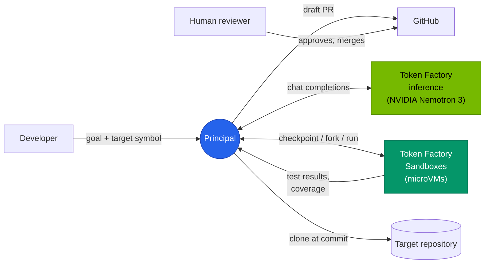
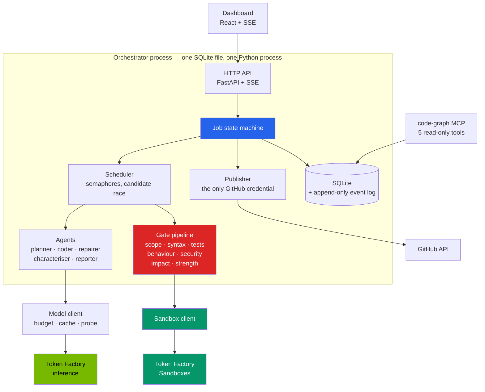
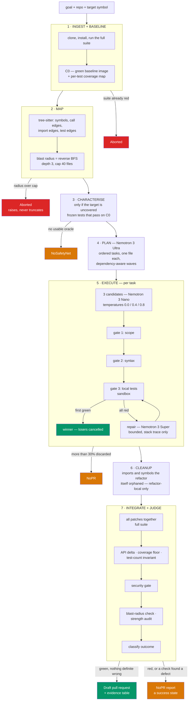
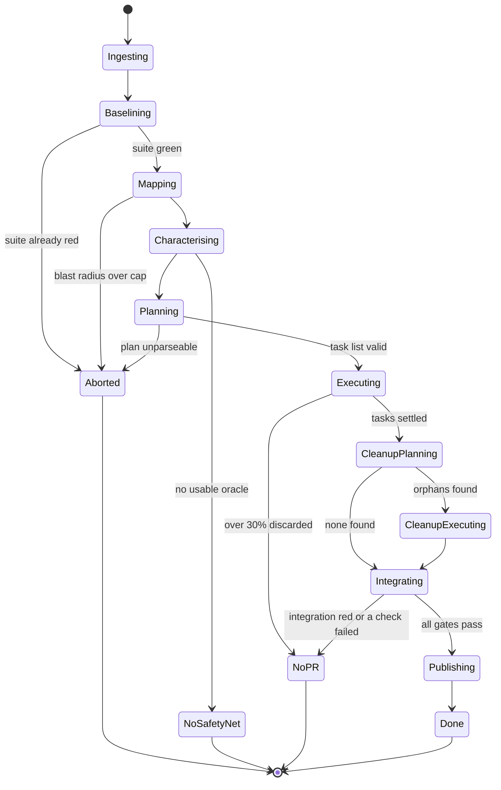
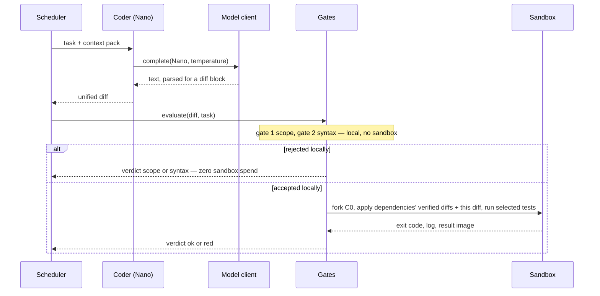

<div align="center">

# Principal

### Refactors that arrive **already verified**.

**An autonomous technical-debt remediation swarm. It rewrites a real repository across dozens of files, and it will not open a pull request unless the repository's own tests are green.**

[](https://github.com/BugHunterX2101/AMTDRS/actions/workflows/ci.yml)
[](LICENSE)


**[Live demo](https://amtdrs.onrender.com)** · **[Console](https://amtdrs.onrender.com/app/)** · **[Architecture](#architecture)** · **[Quickstart](#quickstart--no-credentials-needed)** · **[What is verified](#verification-ledger--what-in-this-readme-was-checked-and-how)**

</div>

Built for the **[Nebius × NVIDIA Global AI Hackathon 2026](https://nebiusglobalaihackathon.devpost.com/)** — track: **Coding and Agentic Engineering**.

---

## In 30 seconds

| | |
|---|---|
| **The problem** | AI writes a wide refactor in minutes. A human then spends hours reviewing forty edits to find the one that is wrong. **Generation is cheap; verification is the bottleneck.** |
| **The idea** | Replace *one careful attempt* with **many cheap parallel attempts and one hard gate**. Race several candidate patches inside private sandboxes; keep the first that passes the repository's real tests; throw the rest away for free. |
| **The guarantee** | **Fail closed. No green test, no PR.** `NoPR` is a success state — "I tried, here is what I tried, I could not verify it, so I am not shipping it." |
| **What makes it different** | **No model in the accept path.** The decision is a `pytest` exit code from a real run in a real microVM, and an import contract enforced in CI stops the gate code from ever importing the model code. |
| **Honest by construction** | Every run is classified **VERIFIED / UNVERIFIED / FAILED / ERROR**. A green suite that never exercised the changed code is reported as *unverified*, not as success. |

| | |
|---|---|
| **Track** | **Coding and Agentic Engineering** — agents that write, run and test code in Token Factory Sandboxes |
| **Runs on** | **Nebius Token Factory** — inference **and** Sandboxes |
| **Models** | **NVIDIA Nemotron 3** — Nano 30B-A3B · Super 120B-A12B · Ultra 550B-A55B |
| **Stack** | Python 3.11+ · FastAPI + SSE · SQLite · tree-sitter · React + Vite · MCP |
| **License** | **Apache 2.0** |
| **Last verified** | **2026-10-22**: `pytest -q` → **465 passed** · `ruff check` clean · `lint-imports` → **3 contracts kept, 0 broken** (local, Windows). CI on commit `93879e5` passed on Ubuntu and Windows, Python 3.11 and 3.12 ([run 39652989780](https://github.com/BugHunterX2101/AMTDRS/actions/runs/39652989780)). Counts drift as the code changes; the [CI badge](https://github.com/BugHunterX2101/AMTDRS/actions/workflows/ci.yml) is the live signal. |

---

## Contents

1. [The problem](#the-problem)
2. [Why *wide* refactors specifically](#why-wide-refactors-specifically)
3. [How it works](#how-it-works) — the gates, the four outcomes, and the live runs so far
4. [Architecture](#architecture) — five Mermaid diagrams
5. [Design decisions worth reading the code for](#design-decisions-worth-reading-the-code-for)
6. [How NVIDIA models and Nebius services are used](#how-nvidia-models-and-nebius-services-are-used)
7. [What a run costs](#what-a-run-costs)
8. [Where this sits in the market](#where-this-sits-in-the-market)
9. [Quickstart — no credentials needed](#quickstart--no-credentials-needed) · [Full setup](#full-setup--with-nebius-token-factory)
10. [Running it](#running-it) — API, dashboard, MCP server, benchmark, deploy
11. [Repository structure](#repository-structure)
12. [Safety](#safety) · [What is *not* claimed](#what-is-not-claimed)
13. [Verification ledger](#verification-ledger--what-in-this-readme-was-checked-and-how)

---

## The problem

The technical debt that costs real money has a specific shape:

> A signature change that touches **forty call sites across nine modules**, where being right in eight modules and wrong in the ninth is *worse than not starting* — because now a human must review a large diff to find the one mistake.

Deprecating a parameter, renaming a widely used internal API, threading a new context object through a call chain: these block framework upgrades and sit in a "modernisation" epic for quarters, because the diff is too wide to review confidently and too mechanical to be interesting. The cost sits in **review**, not in writing the patch.

The public evidence points the same way:

- Technical debt is estimated at **21–40% of IT spending** by Deloitte's [2026 Global Technology Leadership Study](https://www.deloitte.com/us/en/insights/topics/technology-management/technical-debt-impact.html), which itself notes the range is hard to measure and has no standard benchmark.
- In the [2025 Stack Overflow Developer Survey](https://survey.stackoverflow.co/2025/), **84%** of respondents were using or planning to use AI tools, yet only **29%** said they trust them ([Stack Overflow, 2026](https://stackoverflow.blog/2026/02/18/closing-the-developer-ai-trust-gap/)), and **66%** named *"AI solutions that are almost right, but not quite"* as their top frustration.
- Google's [2025 DORA report](https://dora.dev/dora-report-2025/) says AI's primary role is **"an amplifier, magnifying an organization's existing strengths and weaknesses."**

**Generation is solved and cheap. Verification is unsolved and expensive, and it is now the constraint.** A tool that *sometimes* ships an unverified change is worth less than no tool, because it poisons every diff it produces with the possibility that this is one of the bad ones. `NoPR` converts an unbounded review task back into a bounded one.

---

## Why *wide* refactors specifically

The claim that this is unsolved is measured, and the measurement is public.

[**SWE Atlas Refactoring**](https://labs.scale.com/leaderboard/sweatlas-refactoring) (Scale Labs) is the closest public proxy for this work: **70 tasks** from **10 production repositories**, **6 languages** (Go, TypeScript, Python, C, C++, JavaScript), **4 refactor types** — decomposition (29), interface evolution (20), extraction (14), relocation (7).

Leaderboard, **read live on 2026-10-21**:

| Rank | System | Score |
|---:|---|---:|
| 1 | GPT 6 Astra (Codex) xHigh | **59.05** ±6.43 |
| 2 | Fable-5.1 (Claude Code) xHigh | 56.67 ±6.52 |
| 3 | Fable-5 (Claude Code) xHigh | 54.76 ±6.76 |
| 4 | Opus-4.7 (Claude Code) | 48.57 ±6.73 |
| 5 | Opus 4.8 (Claude Code) | 46.67 ±6.75 |
| … | … | … |
| 17 | Gemini-3-Flash (Mini-SWE-Agent) | 10.00 ±4.80 |

**The best system on the board solves fewer than six in ten, with a confidence interval of about ±6.** A model that is right 59% of the time on a wide refactor is unusable if you ship its first answer — and very useful if you can generate several answers cheaply and let a test suite pick.

> **The thesis: the remaining gap is a *scaffolding* problem more than a *weights* problem.** That is an engineering problem, and it is the one Principal solves.

> A leaderboard moves. Re-check before quoting. Principal has **not** been run against SWE Atlas — see [What is *not* claimed](#what-is-not-claimed).

---

## How it works

For each unit of work Principal:

1. generates **several independent candidate patches in parallel** (3 per task, temperatures **0.0 / 0.4 / 0.8**);
2. pushes each through **the gates**, cheapest first;
3. **races them — the first to go green wins**;
4. **cancels the losers**, whose failure costs nothing because it happened inside a private sandbox fork nobody ever sees.

Two properties make that more than a trick:

- **No scoring function, no model in the accept path.** The decision is a `pytest` exit code, not a language model's opinion of a diff.
- **Losing is free.** A failed candidate corrupts only its own fork — there is no shared working tree to clean up.

### The gates

Ordered so that most bad candidates die *before* they touch a sandbox — which is what makes generous fan-out affordable. **You can afford to be wrong eight times out of nine if eight of those failures are free.**

| Gate | What it proves | Runs where | Cost |
|---|---|---|---|
| **1 · Scope** (`gates/scope.py`) | the patch touches only its one target file — never a test, a manifest or a lockfile | local | microseconds |
| **2 · Syntax** (`gates/syntax.py`) | every changed file still parses (tree-sitter) | local | milliseconds |
| **3 · Local tests** (`gates/tests.py`) | the tests that actually cover the changed lines pass | Token Factory Sandbox | seconds |
| **4 · Integration + behaviour** (`gates/behaviour.py`) | all accepted patches pass **together**; public API delta matches the plan's *declared* removals; **coverage may not fall**; **test count may not shrink** | Sandbox, once | seconds |
| **5 · Security** (`gates/security.py`) | the patch introduces **no new** security finding — *differential*, rule-based, deterministic | local | milliseconds |
| **4b · Blast-radius check** (`gates/impact.py`) | what the patch changed matches what the graph says it should have reached | local + sandbox | seconds |
| **4c · Strength audit** (`gates/strength.py`) | would the passing tests *notice* a mistake? Injects deliberate faults into only the changed lines and re-runs the covering tests | Sandbox | seconds |

None of these gates calls a model, and the import contract below makes that a machine-checked fact rather than a promise.

### What a finished run tells you

Green tests are necessary, not sufficient. Every finished run is classified into **exactly one** outcome by a pure function of its stored record (`principal/outcome.py` — no database read, no model call, no clock):

| Outcome | Meaning | Offered |
|---|---|---|
| **VERIFIED** | the tests pass and every check that ran came back clean | draft PR |
| **UNVERIFIED** | no definite defect, but something is still open — a call site no test exercises, tests that missed injected faults, a partial migration, or nothing could be checked | draft PR flagged for a human, or nothing |
| **FAILED** | a check found a **definite** defect (incompatible with code outside the changed files, patches fail together, or a new security finding) | nothing |
| **ERROR** | the **platform** failed — says nothing about the patch and is never counted against it | nothing |

- The **strength audit is a measurement, not a proof**: a run that could not be measured says so instead of defaulting to a flattering score.
- Every finished run has an **evidence bundle** (`GET /jobs/{id}/evidence.zip`): the verdict, each gate's result, every attempt's diff and test log with **SHA-256** hashes (a file changed after the run is flagged), and the command that reproduces the run.

### Live runs so far

Six end-to-end jobs have been run on the real Nemotron models and the real Nebius sandbox. Each is a single run, not a rate.

#### Run 1: weak-tests repository, UNVERIFIED

The first job ran on the weak-tests repository ([`principal-weak-repo`](https://github.com/BugHunterX2101/principal-weak-repo)) with **Nemotron 3 Nano** coders and **Nebius Sandboxes** (its trace records real platform operation ids, not `fake-op-N`). Goal: *"Improve `pricing.calc_total`: remove magic constants and add type hints without changing behaviour."*

- State **Done** — both tasks verified, integration **pass**, security **0 introduced findings**.
- Outcome **UNVERIFIED**, not VERIFIED: the strength audit caught **0 of 1** injected faults (floor 60%), and `src/reports.py:11–12` reaches the target through `getattr`, which no test executes.
- **6 attempts**, **17,822 tokens** of a 2,000,000 budget, sandbox cost **$0.0037**.

That is a single run, not a rate. Principal produced a change whose tests pass, and then **refused to call it verified** — which is the point. *(This job predates provenance recording, so its stored evidence bundle reads "NOT LIVE · unknown"; the label is conservative, and newer runs record LIVE/NOT LIVE at start.)*

#### Run 2: weak-tests repository, cache off, UNVERIFIED

Same repository and goal, with the model cache off (every call went to the platform), after the token ledger was fixed:

- **Different result — the same job is not deterministic.** All three Nano candidates and both Super repairs failed (two unparseable diffs, one empty reply, one context mismatch, one rejected patch), so the task was discarded, **no change was produced**, and the outcome was **UNVERIFIED** with the repository left untouched. The first run above produced a change; this one did not.
- **Models, per role, from the ledger:** planner on **Nemotron 3 Ultra** (`nvidia/Nemotron-3-Ultra-550b-a55b`, 1 call, 2,824 tokens), coders on **Nemotron 3 Nano** (2 billed calls, 20,622 tokens), repairers on **Nemotron 3 Super** (2 calls, 3,265 tokens).
- **The ledger reconciles: 26,711 tokens charged, 26,711 attributed, 0 unattributed.** Before the fix the same job charged 26,626 against 22,761 attributed, because a cancelled or failed model call kept its up-front reservation. Two bugs caused it: a cancelled call never refunded its reservation, and the characterisation step charged its call twice (the second one did not fire in this run — it is covered by a test, not by this measurement).
- It is still one run. It shows the accounting is sound and the platform is reachable; it does not show a success rate.

#### Run 3: `mini_repo`, UNVERIFIED

A repository with strong tests: the bundled `mini_repo` fixture, published as the orphan branch `fixture/mini-repo` so the sandbox can clone it. Goal: make `create()`'s `ttl` keyword-only and update every call site.

- Outcome **UNVERIFIED**, state `NoPR`: the planner (Ultra) split the goal into **6 tasks**, **4 settled** with a winning candidate that passed the local tests, **2 were discarded** after Nano and Super both failed to produce a usable diff, and 2 of 6 exceeds the 30% discard cap, so the job stopped with the repository unchanged. **It did not reach VERIFIED.**
- **The ledger reconciles with many cancelled candidates in play: 58,409 tokens charged, 58,409 attributed, 0 unattributed.** Most failures were `DIFF_UNPARSEABLE` (no `<<<DIFF … DIFF>>>` block in the reply); at least one Nano reply used 2,985 of its 3,000-token cap, which may be truncation, though this run does not prove it.
- At this point three live runs on two repositories existed and none was VERIFIED; the first run's tests passed but could not cover a dynamic call. That was evidence about the pipeline's honesty, **not** a claim that it succeeds on this task.

#### Run 4: `mini_repo` after the diff-parser fix, UNVERIFIED

Same goal, after the diff-parser fix (a reply ending its block with an indented ` DIFF>>>` or a bare `>>>` is now read; hunk matching is unchanged):

- State **Done**, outcome **UNVERIFIED**. The planner split the goal into **7 tasks**: **5 verified**, **2 discarded** (2 of 7 is under the 30% cap, so the job went on to integration). Integration **passed**, security found **0 introduced** findings, and the strength audit detected **8 of 10** injected faults (score 80%, floor 60%).
- **It is not VERIFIED, and should not be.** One of the two discarded tasks was `src/auth/session.py`, the file that defines `create()`. The five call sites now pass `ttl` by keyword, which the old signature still accepts, but `ttl` is **not** keyword-only. The other discarded task left `src/legacy/compat.py` on the old form. Both are listed as open caveats.
- **The ledger reconciles: 69,748 tokens charged, 69,748 attributed, 0 unattributed, across 21 model calls.** Of the attempts, 5 passed, 2 failed tests, 10 were rejected as unusable diffs and 2 were model errors; 6 have no verdict, which in a finished run means they were cancelled after another candidate won (this run predates recording them as `cancelled`). No pull request was opened, because publishing is not configured on this machine.
- The reporter's single call used exactly its 2,000-token output cap, so its reply was probably cut off and the deterministic fallback report used instead. That is an inference from the count, not something this run recorded. The cap is now 6,000 tokens, and a fallback is logged.

#### Why `session.py` kept failing, and what changed

Every task was verified alone against `C0`. Making `ttl` keyword-only breaks every positional caller, so the definition's task could never pass on a tree whose callers had not been updated — no model could have produced a passing diff. Three fixes followed, each covered by tests:

- **Dependency-aware verification** (above): a task is tested on `C0` plus the verified diffs of the tasks it depends on, and the planner is told to order a breaking change so consumers come first.
- **Blank-line tolerance when locating a hunk**, only as a fallback when the exact context is not in the file: a blank context line may match one blank file line or none, and blank lines the hunk left out are kept. Every line with content still has to match exactly. This was a real Nano reply, rejected for writing one blank line where the file had two.
- **The fixture's own tests were changed.** `mini_repo`'s tests called `create(user, 120)` positionally, so the goal *"make `ttl` keyword-only"* could not pass them — any correct change was red. The tests now pass `ttl` by keyword, and `src/registry.py`'s `dispatch()` forwards keyword arguments; the assertions are unchanged, and a hand-written full migration passes all 14 tests. This changes the benchmark, so it is stated here: the fixture branch moved from `654e86c` to [`3d11f55`](https://github.com/BugHunterX2101/AMTDRS/tree/fixture/mini-repo).

#### Run 5: fixture `3d11f55`, dependency-aware verification, UNVERIFIED

Job `01M5FTFZPQ3VS87HF00F0RN2K5`, before the blank-line fix:

- State `NoPR`, outcome **UNVERIFIED**.
- The planner made `session.py` depend on all five consumer tasks. 4 consumers verified; `refresh.py` was discarded after every reply failed to locate its hunks (one blank line where the file had two), so `session.py` was tested without it and failed red twice. 2 of 6 discarded exceeds the cap.
- Ledger **56,261 = 56,261** across 20 calls.

#### Run 6: VERIFIED

Job `01M5FTZVBPDH18S99QN4BW9ANB`, same fixture and goal, model cache off, after the blank-line fix:

- State **Done**, outcome **VERIFIED**. **6 of 6 tasks verified**, all by a first-round Nano candidate (no Super repair needed); 12 other candidates were cancelled once a sibling won.
- The definition changed: `def create(user, ttl=DEFAULT_TTL)` → `def create(user, *, ttl=DEFAULT_TTL)`. The impact check counted **9 of 9 call sites changed**, 0 unexpected files, and both dynamic paths in `src/registry.py` **exercised by tests**.
- Integration **passed**, security **0 introduced** findings, strength audit **7 of 9** injected faults detected (78%, floor 60%; the two survivors are `120 → 121` and `10 → 11` in literal TTLs).
- **19,855 tokens** across 10 model calls (ledger 19,855 = 19,855). No pull request, because publishing is not configured on this machine.
- **One run, not a rate.** It is the first VERIFIED result, it came after the fixture's tests were changed (above), and the previous five runs on these two repositories did not reach VERIFIED.

#### The weak-tests repository now has tests for its callers

[`principal-weak-repo`](https://github.com/BugHunterX2101/principal-weak-repo) commit `4ec27e0` adds tests that cover `calc_total`'s keyword and explicit-tax uses, its two callers and the `getattr` path in `src/reports.py`. The benchmark stays pinned to `3fd067a`, the weak version, because that is the case it measures; no live run has been made at `4ec27e0`.

---

## Architecture

### System context



Principal never merges anything. **The reviewer is inside the trust boundary by design**, not an optional extra — every guarantee here assumes a human approves before code lands.

### Containers



**Dependencies point downward only**, enforced in CI by `import-linter` (`lint-imports`, **3 contracts**):

- **No model in the accept path** — `principal.gates` cannot import `principal.models` or `principal.agents`
- **Agents never touch the sandbox** — `principal.agents` cannot import `principal.sandbox` or `principal.publish`
- **Layered architecture** — `api` → `orchestrator` → `gates | agents | publish` → `routines` → `sandbox | models | graph` → `db` → `config`; nothing imports upward

The first rule is the architecture's central claim expressed as something a machine checks rather than a sentence in a README. The contracts are defined in [`pyproject.toml`](pyproject.toml).

### The verification pipeline



### Job state machine

The states below are the ones `principal/orchestrator/job.py` actually writes.



`NoPR` and `NoSafetyNet` are drawn with the same visual weight as `Done` throughout the dashboard, **on purpose**. They are correct results — the system did its job and declined to ship — and rendering them as errors would teach the opposite of the intended lesson. `Aborted` is reserved for a run that *could not* proceed (red baseline, oversized radius, platform failure).

### One attempt, in sequence



The `alt` branch **is the cost model made visible**: a locally rejected candidate spends one cheap completion and zero sandbox operations, which is why three candidates per task is affordable at all.

---

## Design decisions worth reading the code for

- **The blast radius raises; it does not truncate.** A reverse-edge BFS over call and import edges, **depth 3, capped at 40 files** (`principal/graph/radius.py`). Over the cap, Principal **aborts with `RADIUS_TOO_LARGE`** rather than silently working on the first 40. *Why it matters:* a truncated radius produces a patch that **looks complete and is not** — the most dangerous failure mode this system could have.

- **Unresolved call sites are reported, not hidden.** A dynamic dispatch like `registry[name](user)` cannot be proved to reach the target, so it is listed in the PR under *"what a human must check"*. [`graph/resolve.py`](principal/graph/resolve.py) separates a genuinely unresolvable dynamic call from `len()` — on the bundled fixture, the difference between noise and **exactly 2 real entries**, both in `src/registry.py`.

- **Behaviour preservation beyond "tests pass".** A patch that deletes a function *and its tests* passes. So: the public-API delta must match the plan's **declared** removals, **coverage may not fall**, and the **test count may not shrink**.

- **Per-test coverage drives test selection.** The baseline runs `pytest --cov-context=test`, yielding a test→line map. Each fork runs only the tests that cover the lines it changed — what keeps gate 3 at **seconds rather than minutes**.

- **Characterisation never lets a model write its own exam.** Where the target is uncovered, a Characteriser writes tests — but it **never sees the refactoring goal**, its tests must **pass against the unmodified baseline** or are discarded, they are **frozen** before refactoring starts, and a change verified *only* by generated tests is **reported as such**. Otherwise "model-written code satisfies model-written expectations" would be the whole proof.

- **The security gate is differential.** It scans the baseline and the result and fails only on what is **new** — so it is usable on legacy code full of pre-existing findings. Fingerprints exclude line numbers, since every refactor shifts them. Dependency and licence risk are closed *by construction*: gate 1 rejects any diff touching a manifest or lockfile.

- **The dependency rule is enforced by CI, not discipline.** `import-linter` runs as `lint-imports` — **not** `python -m importlinter.cli lint`, which exits 0 without evaluating a contract. That bug was caught during development; it is exactly the kind of thing that makes a safety claim decorative.

- **The event log is the product.** Every state change is an **append-only row**, streamed as SSE with `Last-Event-ID` resume, and every job writes a JSONL trace. A laptop that sleeps for ten seconds reconnects into a live view, and because the run id lives in the URL (`/app/?job=<id>`) a finished run is **reconstructible from a link alone**.

- **Every safety claim has a fixture.** [`docs/THREAT_MODEL.md`](docs/THREAT_MODEL.md) states the threat matrix and residual risks. `tests/unit/test_adversarial_corpus.py` asserts the exact gate verdict for **10 named adversarial inputs** — including `correct.diff`, which **must pass**, because a gate suite that only proves things get rejected is satisfied by a gate that rejects everything.

- **Live is the default; stand-ins are labelled, never hidden.** Verification and measurement run on the real Nemotron models and the real Nebius sandbox. The in-process `FakeSandbox` (`--fake-sandbox`) is for tests only and prints `mode: DEMO — in-process FakeSandbox, results are NOT live-verified`. The same label is stored on the job, shown as a **NOT LIVE** badge in the console, and written at the top of every evidence bundle and benchmark report.

- **Every model call is itemised.** Each call writes a `model.call` event naming the **role** (planner, coder, repairer, reporter, characteriser), the **tier and model id**, and the prompt / completion / billed tokens. The evidence bundle sums them per role and checks that the total equals the job's `tokens_spent`; any tokens it cannot attribute are reported as a number, not rounded away. A run recorded before this ledger says "not itemised" rather than guessing.

---

## How NVIDIA models and Nebius services are used

> *This section answers the hackathon's requirement to show how NVIDIA Nemotron and other NVIDIA open models were used, where Token Factory accelerated the workflow, and which other Nebius tools and services the project depends on.*

### NVIDIA Nemotron 3 — three tiers, three different jobs

Nemotron 3 is a **hybrid Mamba-Transformer Mixture-of-Experts** family. For Nano 30B-A3B, NVIDIA's model card describes a **52-layer** stack — **23 Mamba-2, 23 MoE and 6 attention layers** — with **3.5B of 30B parameters active** per token ([model card](https://build.nvidia.com/nvidia/nemotron-3-nano-30b-a3b.md); [paper](https://arxiv.org/pdf/2512.20856)). Mamba-2 layers give linear-time long-range modelling, attention layers give precision, and MoE routing activates only a fraction of parameters per token.

That matters here: **wide fan-out is only economical if each candidate is cheap**, and a candidate is a long, low-density prompt — a blast radius, every call site, surrounding context. A dense model at the same accuracy would cost far more per candidate and the "generate three, race them" design would collapse.

| Tier | Model id | Scale | What it does | Why this tier |
|---|---|---|---|---|
| **Nano** | `nvidia/NVIDIA-Nemotron-3-Nano-30B-A3B` | 30B total · 3.5B active | generates candidate patches; summarises failing test output | highest-volume call (3 per task, dozens per job) and the one where being wrong is cheapest — gate 3 catches it |
| **Super** | `nvidia/nemotron-3-super-120b-a12b` | 120B total · 12B active | **repairs** a candidate that failed its tests | narrow, well-specified, but needs real reasoning about *why* a test failed — without Ultra's latency inside a retry loop |
| **Ultra** | `nvidia/Nemotron-3-Ultra-550b-a55b` | 550B total · 55B active | **plans** — decomposes the goal into an ordered, dependency-aware task list | runs **once per job** and every downstream decision inherits its mistakes — the one place to pay for the best long-horizon reasoning |

Every model call is tagged with its tier and its token cost is recorded in the run metadata, so **the routing is measurable rather than asserted**. The planner tier is configurable (`PRINCIPAL_PLANNER_TIER=super|ultra`, default **ultra**) so the Super-versus-Ultra question can be *measured* with `bench/` rather than assumed.

#### The `reasoning_content` trap, and the boot-time capability probe

1. Reasoning models behind an OpenAI-compatible API can return output in `reasoning_content` and leave `content` **empty**.
2. Code that trusts `choices[0].message.content` gets an empty string.
3. **An empty string is not an error** — it is a *successful* API call that silently produces nothing.
4. The failure then surfaces three layers away as *"the agent generated no patch."*

Principal does not guess. At boot it runs a **3×3 capability probe** — each of the three models against each of the three output protocols (JSON schema / tool calls / fenced text) — **pins each model to the protocol it demonstrated**, and prints the table. `PRINCIPAL_FORCE_PROTOCOL` pins one protocol for everything. `PRINCIPAL_REQUIRE_LIVE=1` makes startup **fail** unless inference *and* Sandboxes both verify, so a live deployment cannot silently fall back to the credential-less demo; `/healthz` reports `inference_verified`, `sandbox_verified` and `live`.

```
model                                    schema  tools  text   chosen
nvidia/NVIDIA-Nemotron-3-Nano-30B-A3B    ok      ok     ok     schema
nvidia/nemotron-3-super-120b-a12b        ok      ok     ok     schema
nvidia/Nemotron-3-Ultra-550b-a55b        ok      ok     ok     schema
```

*(Illustrative of the table's shape; the probe runs against your own key at startup.)*

### Nebius Token Factory — Sandboxes are the whole design

**1 · Inference.** The OpenAI-compatible endpoint at `https://api.tokenfactory.nebius.com/v1/`. The model layer is the official `openai` SDK with a different `base_url` — **no custom HTTP client**. Default rate limits per Nebius's [documentation](https://docs.tokenfactory.nebius.com/ai-models-inference/rate-limits.md): **60 requests/min and 400,000 tokens/min**, scaling **+20% per 15-minute window** when usage averages **≥80%**, to a ceiling of **20× base**. The client reads `x-ratelimit-remaining-*` headers and shows headroom **live on the dashboard**.

**2 · Sandboxes.** Every sandbox is its **own microVM, built to run untrusted code**, with Git-like branching: fork execution state at any checkpoint, explore in parallel, roll back instantly. The Contree SDK exposes this as **one content-addressed primitive**:

```python
# Two runs of the identical command from the identical parent return the
# identical image UUID — no new execution, no new cost.
same1 = await image.run(shell="echo same", disposable=False)
same2 = await image.run(shell="echo same", disposable=False)
assert same1.uuid == same2.uuid
```

Two consequences are load-bearing:

- **Checkpoint-fork is the unit of state.** The green baseline `C0` is built **once** — clone, install, run the suite — and every candidate for every task forks from it. Dependency installation, usually the dominant cost of CI-like work, is paid **once per job**, not once per candidate: with three candidates across a dozen tasks, **one install instead of thirty-six**.
- **A task is tested with the work it depends on.** A candidate's fork gets the verified diffs of the task's dependencies (in plan order) before its own, so a breaking change can be tested once its consumers are updated. The stored winning diff stays the task's own, so integration applies each change exactly once. The planner orders a breaking change so that consumers come first, written to work with both interfaces.
- **Failure is free because it is private.** A candidate that breaks the build breaks *its own fork*. No shared mutable tree to corrupt, no cleanup, no interference between parallel attempts.

> **Sandboxes made the parallel search *affordable*, not merely faster.** On ordinary containers you would have to either serialise the work (losing the parallelism the thesis depends on) or reinstall dependencies per candidate (losing the economics).

Gates 3 and 4 are real `pytest` runs on real installed dependencies in an isolated microVM: the accept decision is a **process exit code from a genuine test run**. Documented beta limits ([Sandboxes docs](https://docs.tokenfactory.nebius.com/sandboxes/operate/limits-retention-and-usage.md)): **50 simultaneous operations**; checkpoint images **retained 180 days**, after which *untagged and unreferenced* images may be deleted.

| Component | Use |
|---|---|
| Token Factory OpenAI-compatible API | all inference (`openai` SDK, changed `base_url`) |
| Token Factory Sandboxes (`contree-sdk`) | baseline build, gates 3 and 4, strength audit |
| Rate-limit headers | live budget headroom in `GET /jobs/{id}` and the dashboard |
| Model registry (`GET /v1/models`) | model ids resolved at boot, so a typo fails in seconds, not mid-job |
| NVIDIA Nemotron 3 Nano / Super / Ultra | candidates / repairs / planning |

Engineering feedback on all of the above — **nine issues ranked by what they cost**, several checked against the installed SDK source rather than the docs — is in **[`docs/FEEDBACK.md`](docs/FEEDBACK.md)**.

---

## What a run costs

Principal ships a **default per-job budget of 2,000,000 tokens** (`token_budget_default` in [`principal/config.py`](principal/config.py)), enforced by a **reserve-and-refuse** manager: it refuses rather than truncates.

**Prices.** Nebius's own price list sits behind the console login, so the table below uses **third-party listings** and should be confirmed against `GET /v1/models?verbose=true` with your key before you rely on it:

| Tier | Input / 1M | Output / 1M | Source |
|---|---:|---:|---|
| Nano | $0.06 | $0.24 | third-party estimator listings, Oct 2026 |
| Super | $0.30 | $0.90 | a reseller listing, **not** confirmed Nebius pricing |
| Ultra | $1.00 | $3.00 | two third-party listings agree |

- **Worst case**, every one of the 2,000,000 budgeted tokens billed as Ultra output: 2 × $3.00 = **$6.00**. This bound depends only on the *highest* listed rate.
- **Measured case.** Run 1 above spent **17,822 tokens**; at the highest Nano rate that is **under half a cent** of model cost, plus **$0.0037** of sandbox cost reported by the platform.

Against **$85–110/hour** fully loaded engineering time and a half-day-to-two-day wide refactor, the interesting number is **not the token cost — it is that the cost of a wrong attempt fell to zero**, because it died in a private fork nobody reviews. Principal does not remove the reviewer; it changes the review from auditing forty edits for one mistake to sanity-checking a change that already passed a real suite.

> The $85–110/hour figure and the refactor duration are assumptions carried from the design documents, not measurements. List prices and one run are not a customer case study — **no production deployment has been measured.**

---

## Where this sits in the market

Two mature categories each cover part of the problem. Neither covers the middle.

| | **Coding agents**<br>(Codex, Claude Code, Cursor, Devin) | **Deterministic mass refactoring**<br>([OpenRewrite](https://docs.openrewrite.org/) / [Moderne](https://moderne.ai/)) | **Principal** |
|---|---|---|---|
| Handles a *novel*, bespoke refactor | yes | no — needs a pre-written recipe | **yes** |
| Correctness signal | human review | AST transform correct by construction | **real test-suite exit code** |
| Will it ship something unverified? | yes — that is what review is for | no | **no — fails closed** |
| Scales across many repositories | partially | **yes** — its whole design | one repository per job |
| Measured ceiling on wide refactors | top of SWE Atlas: **59.05** | n/a — not a model | not yet measured; **races several attempts** |

- **Coding agents** are general but unverified — they hand you the review problem.
- **OpenRewrite / Moderne** is the serious incumbent (Moderne raised a **$30M Series B, led by Acrew Capital, on 11 Feb 2025** — [TechCrunch](https://techcrunch.com/2025/02/11/moderne-raises-30m-to-solve-technical-debt-across-complex-codebases/)): deterministic transforms are exceptionally safe but **require someone to write the recipe first**.
- **Principal takes the third position:** LLM generality for the diff, deterministic machinery for the decision — *the model proposes, a real test run in a real sandbox disposes.*

---

## Quickstart — no credentials needed

Principal runs its entire **deterministic half** with **no Nebius account** — against a bundled fixture repository, using an in-process sandbox that executes real `git` and real `pytest`.

- **You get, free:** a genuinely verified green baseline, real per-test coverage, a real tree-sitter code graph, a real blast radius.
- **It stops at planning:** generating a patch needs an inference key.

That boundary is deliberate: **everything you can check for free is the half a model cannot fake.**

```bash
git clone https://github.com/BugHunterX2101/AMTDRS.git
cd AMTDRS

python -m venv .venv
source .venv/bin/activate          # Windows: .venv\Scripts\activate
pip install -e ".[dev]"

principal doctor
```

With no credentials you should see passes, **three warnings**, and `doctor: ready`:

```
  [PASS] python                     3.14.6 (need >= 3.11)
  [PASS] import tree_sitter         source parsing
  [PASS] import tree_sitter_python  Python grammar
  [PASS] import openai              Token Factory inference client
  [PASS] import contree_sdk         Token Factory Sandboxes client
  [PASS] import fastapi             HTTP API
  [PASS] database                   principal.db — 12 tables, migrations applied
  [WARN] nebius_api_key             unset — Principal will run against the in-process FakeSandbox with no inference…
  [WARN] nebius_project_id          unset — Sandboxes are authorised per project…
  [WARN] github                     GITHUB_TOKEN or PRINCIPAL_FORK_REPO unset — no pull request is opened.
  doctor: ready
```

Now the static analysis, which needs only the source tree:

```bash
principal radius \
  --repo tests/fixtures/mini_repo \
  --commit deadbeef \
  --target src.auth.session.create
```

In **under a second** (measured: 0.7 s) that prints everything a change to `create()` can reach, at **reverse-BFS depth 3**:

- **7 source files** and **2 test files** (14 test cases) inside the radius
- **24 call sites**, all `static` — **14 naming `create` itself**, 8 of them in `src/`
- **2 genuinely unresolvable dynamic dispatches**, both in `src/registry.py`

Then run a job — on the **real** Nemotron models and the **real** Nebius sandbox. Credentials go in the process environment only, never in a file:

```bash
export NEBIUS_API_KEY=...  NEBIUS_PROJECT_ID=...
export PRINCIPAL_REQUIRE_LIVE=1     # refuse to start unless both backends answer

principal run \
  --repo https://github.com/BugHunterX2101/principal-weak-repo \
  --commit 3fd067a7d5b8f0152b54e1922be821ff1b2f786c \
  --target src.pricing.calc_total \
  --goal "Improve pricing.calc_total: remove magic constants and add type hints without changing behaviour"
```

> **The repository must be a public git URL.** The Nebius sandbox clones it inside its own microVM, so a local path such as `tests/fixtures/mini_repo` cannot be reached and ends at the baseline step with exit `97` (`BASELINE_RED`). That is why this example uses a public repository.

Missing credentials are a **hard error** (`refusing to run: …`), never a silent downgrade, and a run is labelled **LIVE** only when both the sandbox and the inference were real.

`--fake-sandbox` exists for the test suite and is **not** how Principal is verified or measured: it runs real `git` and `pytest` locally against the in-process `FakeSandbox` and prints `mode: DEMO … NOT live-verified`. Nothing in this README's claims about the platform rests on it.

Run the tests:

```bash
make test          # or: pytest — 465 tests, unit + integration
make lint          # ruff + import-linter (the architecture contracts)
```

## Full setup — with Nebius Token Factory

```bash
cp .env.example .env
```

| Variable | Where it comes from | Notes |
|---|---|---|
| `NEBIUS_API_KEY` | Token Factory console → API keys | inference **and**, by default, the Sandboxes bearer token |
| `NEBIUS_PROJECT_ID` | Token Factory console → your project | sent as the mandatory `Project` header by the Contree SDK |
| `CONTREE_TOKEN` | *(optional)* a separate Sandboxes token | preferred over `NEBIUS_API_KEY` for every sandbox call |

> **Sandbox access is granted per project, not per key.** A key that does inference perfectly may still get `403` on Sandboxes — the **single most common setup failure**. `principal doctor` therefore probes them as **two separate checks** and tells you which is broken.

> **Credentials live in environment variables or an untracked `.env` only.** `.env` is gitignored. Never commit a key.

```bash
principal doctor          # expect PASS on inference, all three models, and sandboxes
principal serve           # http://127.0.0.1:8000
```

### Optional: opening pull requests

| Variable | Value |
|---|---|
| `GITHUB_TOKEN` | a **fine-grained** token with exactly `contents: write` and `pull_requests: write` |
| `PRINCIPAL_FORK_REPO` | `owner/name` of the fork Principal pushes branches to |

> **Scope the token to a fork you own — never to an upstream repository.** Principal opens **draft** PRs only. Leave both unset and jobs still run to completion and produce the full verification report; only the publish step is skipped.

### Tunables

Every tunable lives in [`principal/config.py`](principal/config.py) and is **recorded into each job's metadata**:

| Setting | Default |
|---|---:|
| `candidates_per_task` | **3** |
| `max_repairs` | **2** |
| `radius_max_depth` / `radius_file_cap` | **3** / **40** |
| `max_tasks` | **12** |
| `max_parallel_tasks` / `max_inflight_ops` | **8** / **24** |
| `max_discard_ratio` | **0.30** |
| `token_budget_default` | **2,000,000** |
| `task_timeout_s` / `sandbox_timeout_s` | **300** / **600** |
| `strength_audit_cap` / `strength_floor` | **20** / **0.60** |

---

## Running it

### HTTP API

```bash
principal serve --host 0.0.0.0 --port 8000
```

| Method | Path | Purpose |
|---|---|---|
| `GET` | `/healthz` | liveness + what the process is actually configured to talk to |
| `POST` | `/jobs` | start a job — returns `202` and an SSE stream URL |
| `GET` | `/jobs/{id}` | state, counts, token budget, live rate-limit headroom, and — once finished — the `outcome` and `provenance` |
| `GET` | `/jobs/{id}/evidence` | the evidence bundle as JSON |
| `GET` | `/jobs/{id}/evidence.md` | the same, as a readable report |
| `GET` | `/jobs/{id}/evidence.zip` | the report plus every diff, test log and coverage artifact, with a **SHA-256** manifest |
| `GET` | `/jobs/{id}/events` | SSE, resumable via `Last-Event-ID` |
| `GET` | `/jobs/{id}/tree` | the sandbox fork tree |
| `GET` | `/artifacts/{id}` | any diff, test log or report by id |
| `POST` | `/jobs/{id}/cancel` | cancels in-flight sandbox operations too |
| `GET` | `/debug/blast-radius` | blast radius of any symbol, no job required |

Errors are a **documented envelope, not a bare 500**: `PrincipalError` carries a machine-readable `code`, a `retryable` flag and the `job_id`, and an app-level handler maps codes to status — `TARGET_NOT_FOUND` → **404**, `RADIUS_TOO_LARGE` → **422**, `BUDGET_EXHAUSTED` and `MODEL_RATE_LIMITED` → **429**, anything unmapped → **400**.

```bash
curl -X POST localhost:8000/jobs -H 'content-type: application/json' -d '{
  "repo_url": "tests/fixtures/mini_repo",
  "commit_sha": "deadbeef",
  "target_fqn": "src.auth.session.create",
  "goal": "make ttl keyword-only and update every call site"
}'
```

### Dashboard

Two pages, one `dist/`, both served by `principal serve`:

| Path | Page |
|---|---|
| `/` | **landing page** — what Principal is and why the guarantee is the product |
| `/app/` | **operator console** — the live run |
| `/app/?job=<job-id>` | any past run, replayed from the event log by the same reducer |

```bash
cd dashboard && npm install && npm run build
```

- A **LIVE / NOT LIVE** badge taken from the job's own recorded provenance
- The **live fork tree** and per-candidate gate progress
- The **outcome** (verified / unverified / failed / error) with every open reason, plus the **blast-radius check** and **test strength** panels
- **Evidence downloads** (zip, report, JSON) and an **evidence drawer** — diff, test output and coverage delta for any attempt
- **Run economics**, the NoPR report, and a **cancel** control that also stops in-flight sandbox operations
- A run id in the URL, so **a reload or a slept laptop resumes the same run**; `PRINCIPAL_SLOW_MO_MS=250` paces events so the fan-out is legible on video

**Frontend performance** is treated as a budget, not an afterthought. The WebGL2 backdrop renders at half resolution, is capped at 30 fps, pauses off-screen and in hidden tabs, and freezes under `prefers-reduced-motion`; the hero's 3D card stack is pure CSS transforms; fonts are self-hosted. Measured side by side against the previous build (median of 8 interleaved desktop runs, 4 CPU-throttled mobile runs): first paint **514 → 518 ms** desktop and **1206 → 1214 ms** throttled mobile, **0 layout shift**, **148 KB** transferred, **7 requests**.

### Code-graph MCP server

The static analysis is exposed as **five read-only MCP tools**:

| Tool | Returns |
|---|---|
| `find_symbol` | a symbol by name, with its definition span |
| `callers_of` | every recorded caller of an FQN |
| `blast_radius` | the reverse-BFS radius of a symbol |
| `tests_covering` | the tests whose coverage touches a symbol |
| `read_span` | an exact line range of a file |

The same graph is also offered as **resources**, which a client can browse without spending a tool call, and as two **prompts**:

| Resource | Returns |
|---|---|
| `amtdrs://graph/tree` and `amtdrs://graph/tree/{path*}` | one directory level (at most 60 entries), or the symbols of one file |
| `amtdrs://graph/entities/{fqn}` | the symbols matching an FQN, each with its source |
| `amtdrs://graph/blast-radius/{fqn}{?depth}` | the same radius as the tool; `depth` is clamped to 1-6 |
| `amtdrs://jobs/{job_id}/evidence` | the job's evidence bundle |

| Prompt | Returns |
|---|---|
| `plan_change(fqn, goal)` | a brief for changing a symbol: its radius, call sites, unresolved calls and covering tests, with a pointer to `principal run` |
| `relocate_symbol(fqn, destination)` | the same brief for a relocation, built from the importers only |

A resource or prompt for something that does not exist returns an answer saying so, not an error. The tool list is unchanged at five.

`principal serve` mounts the server over **streamable HTTP at `/mcp/`**; `python -m mcp_code_graph.server` runs the same server over **stdio** for any MCP client.

> **Read-only by construction** — no write tool, no shell tool, nothing that names a sandbox. An agent holding this toolset can look at the code and nothing else.

### Benchmark

```bash
make eval          # checks credentials, then runs every arm on every task — live only
make bench         # the same run without the credential check first
```

- **Three arms** over the same tasks: **A** single-shot, no gates · **B** single candidate, gates on · **C** full swarm.
- **Four result buckets** — verified / unverified (tests pass, caveats open) / failed on merit / excluded as infrastructure. Only a run the product itself classifies as **VERIFIED** counts as a win. *Why separate buckets:* collapsing a sandbox timeout into "the patch was wrong" understates the verified rate **and** hides a platform problem.
- **False accepts.** A task can name an independent oracle, a test directory the pipeline never sees. Every run that claims *verified* is then checked against it, and a claim the oracle rejects is a false accept, reported per arm as `n/m` (`—` when nothing was checked). Only `weak_repo-calc-total-types` has an oracle (`tests/fixtures/weak_repo_oracle`). The oracle runs on the host in a scratch copy with credentials removed from its environment, not in the sandbox, which is acceptable for these fixture repositories and not for an arbitrary one.
- **Cost and time columns**, reported as measured. Sandbox cost shows `—` when the platform reported no charge (never `0`, which reads as free); model tokens are counted, not priced.
- The harness has **no offline mode**: it refuses to run without real credentials, and its reports open with a LIVE / NOT LIVE line.

`bench/tasks.json` pins **two tasks, not a suite**: the bundled `mini_repo`, and the weak-tests repository where a green change can still be unverified. The one live run made so far is recorded below.

> **Both tasks point at public git URLs**, because the Nebius sandbox cannot clone a local path (see the quick start). The `mini_repo` task uses the fixture's published branch, `fixture/mini-repo` at `3d11f55`, the same repository and commit as live run 6.

**Live benchmark, 2026-10-22** (`python -m bench.harness`, real Nebius sandbox and real inference, labelled LIVE by the report, one run per cell):

| Arm | Attempted | Verified | Unverified | Failed on merit | Infrastructure exclusions | False accepts | Tokens (mini_repo / weak_repo) |
|---|---|---|---|---|---|---|---|
| A | 2 | 0 | 0 | 2 | 0 | — | 38,586 / 30,730 |
| B | 2 | 0 | 1 | 1 | 0 | — | 50,084 / 26,281 |
| C | 2 | 0 | 1 | 1 | 0 | — | 81,736 / 38,298 |

No arm reached VERIFIED on either task, so there is no verified rate to compare. The result is two tasks and one run per cell: it shows nothing about which arm is better, and the differences in tokens and time are within what one run can show. The false-accepts column is `—` everywhere because no run claimed *verified*, so the oracle on `weak_repo` was never exercised live. It is covered only by the unit tests in `tests/unit/test_bench_oracle.py`. Causes recorded: the mini_repo B and C runs ended UNVERIFIED with caveats open; the weak_repo B and C runs ended UNVERIFIED because a task was discarded (1 of 3, over the 30% cap); arm A failed on both tasks (2 of 6 and 3 of 4 tasks discarded). Why the tasks were discarded has not been investigated.

### Deploying the hosted demo

```bash
docker build -t principal .
docker run -p 8000:8000 principal
# with credentials:
docker run -p 8000:8000 -e NEBIUS_API_KEY=... -e NEBIUS_PROJECT_ID=... principal
```

The Dockerfile is two-stage (a Node stage builds the dashboard, a Python stage serves it) and ships a `HEALTHCHECK`. A [`render.yaml`](render.yaml) Blueprint serves **[amtdrs.onrender.com](https://amtdrs.onrender.com)** on a free tier — expect a **cold start of tens of seconds** after idle (one was measured at **33 s**). `GET /healthz` on the live demo reports `"sandbox":"FakeSandbox"` and `"live":false`: **the hosted demo runs the credential-less half and says so.** See [`docs/DEPLOY.md`](docs/DEPLOY.md).

---

## Repository structure

```text
AMTDRS/
├── principal/                        the orchestrator — one process, one SQLite file
│   ├── cli.py                        serve | doctor | run | radius
│   ├── config.py                     every tunable, recorded into each job's metadata
│   ├── errors.py                     error taxonomy: retryable? the system's fault or the platform's?
│   ├── diffs.py                      sentinel extraction + unified-diff parsing (no model here)
│   ├── outcome.py                    VERIFIED / UNVERIFIED / FAILED / ERROR — a pure function
│   │
│   ├── db/
│   │   ├── schema.sql                code graph + run-record tables
│   │   ├── store.py                  typed row access, no ORM
│   │   └── events.py                 event + row in one transaction — the event log is the product
│   │
│   ├── graph/                        tree-sitter parsing → the code graph
│   │   ├── languages/                grammar registry (python.scm, typescript.scm)
│   │   ├── parse.py · build.py       parsing; two-pass construction (symbols, then edges)
│   │   ├── resolve.py                static vs. heuristic callee resolution
│   │   ├── radius.py                 reverse-edge BFS, depth 3, cap 40 — raises, never truncates
│   │   ├── recall.py                 call-site recall: how much of the real consumer set the radius reached
│   │   └── embed.py                  convention examples only
│   │
│   ├── sandbox/                      Contree SDK wrapper — the only writes in the system
│   │   ├── client.py                 operation-id capture for cancellation + crash recovery
│   │   ├── baseline.py               C0 construction, tagging, coverage
│   │   ├── fake.py                   in-process stand-in with real content-addressed semantics
│   │   └── runner.py · scripts.py    one run per attempt, sentinel parsing; shell templates per phase
│   │
│   ├── models/                       Token Factory client
│   │   ├── registry.py               resolve model ids against list-models at boot
│   │   ├── probe.py                  the 3×3 capability probe
│   │   ├── protocols.py              schema / tools / text adapters; the reasoning_content trap
│   │   ├── client.py · budget.py     the only place a token is spent; reserve-and-refuse
│   │   └── cache.py                  content-addressed disk cache
│   │
│   ├── agents/                       one pure function per role, no shared memory
│   │   ├── contracts.py              pydantic models for every agent's input/output
│   │   ├── planner.py                Ultra — goal → ordered task list
│   │   ├── coder.py                  Nano — task → unified diff
│   │   ├── repairer.py               Super — failing diff + stack trace → revised diff
│   │   ├── characteriser.py          writes frozen tests where the repo has none
│   │   ├── reporter.py               artifacts → PR title / body / risk list
│   │   └── prompts/*.md
│   │
│   ├── gates/                        deterministic, total, never imports models/ or agents/
│   │   ├── pipeline.py               the Verdict type + ordering
│   │   ├── scope.py                  gate 1 — local
│   │   ├── syntax.py                 gate 2 — local
│   │   ├── tests.py                  gate 3 — selection + sandbox run
│   │   ├── apply.py                  diff application onto the local snapshot
│   │   ├── behaviour.py              gate 4 — API delta, coverage floor, test-count invariant
│   │   ├── security.py               gate 5 — differential, rule-based
│   │   ├── impact.py                 gate 4b — predicted vs. actual blast radius
│   │   ├── strength.py · mutation.py gate 4c — would the passing tests notice a fault?
│   │   └── characterise.py           establishing an oracle where the repo has none
│   │
│   ├── orchestrator/
│   │   ├── job.py                    the state machine
│   │   ├── scheduler.py              semaphores, the candidate race, first-green-wins
│   │   ├── ordering.py               topological + file-conflict wave splitting
│   │   ├── budget.py                 job-level budget decisions
│   │   ├── cleanup.py                imports/symbols the refactor itself orphaned
│   │   ├── signals.py                the facts about a run that decide its outcome
│   │   └── evidence.py               the evidence bundle (JSON / Markdown / zip)
│   │
│   ├── routines/                     one object per kind of refactor (registry + relocation)
│   │
│   ├── publish/
│   │   ├── github.py                 the only GitHub-credential holder, one call site
│   │   └── prbody.py                 evidence-table PR body
│   │
│   └── api/
│       ├── app.py                    FastAPI, lifespan (capability probe, sandbox probe, MCP mount)
│       ├── routes.py                 the 11 endpoints, incl. /healthz
│       ├── stream.py                 SSE from the event table — subscribe first, then replay
│       └── schemas.py                request/response models
│
├── mcp_code_graph/                   5 read-only MCP tools over the code graph
│   ├── server.py                     FastMCP adapter: /mcp/ over HTTP, or stdio
│   └── tools.py                      find_symbol · callers_of · blast_radius · tests_covering · read_span
│
├── dashboard/                        React + Vite, two pages, one dist/
│   ├── index.html                    landing page entry        → /
│   ├── app/index.html                operator console entry    → /app/
│   ├── vite.config.js                multi-page build, dev proxy to the API
│   └── src/
│       ├── App.jsx · components.jsx  console layout; run id lives in ?job=
│       ├── Backdrop.jsx              WebGL2 node-lattice backdrop, half-res, 30 fps cap
│       ├── useJobStream.js           the event-log reducer — resumable via Last-Event-ID
│       ├── styles.css                console styles
│       └── landing/                  Hero · Pipeline · Outcomes · Evidence · Features · ROI
│                                     Compare · FAQ · Finale · Footer · ForkRaceViz · fonts/
│
├── bench/                            three arms, honest bucketed scoring
│   ├── harness.py                    drives a real run_job() per (task, arm); live only
│   ├── arms.py                       A: no gates · B: gates, one candidate · C: full swarm
│   ├── score.py                      verified / unverified / failed-on-merit / excluded-as-infrastructure
│   └── tasks.json                    pinned task definitions
│
├── spikes/                           throwaway scripts that each answer one question
│   ├── spike_sandbox.py              reachability, content-addressed dedup, cancellation
│   └── spike_protocol.py             the 3×3 capability probe, with raw response inspection
│
├── tests/                            465 tests · hermetic: temp DB, FakeSandbox, no network
│   ├── conftest.py
│   ├── fixtures/
│   │   ├── mini_repo/                16 Python files, 14 tests: static call sites, an aliased import,
│   │   │                             dynamic dispatch (2 unresolved edges), an uncovered private symbol
│   │   ├── weak_repo/                tests pass but are weak — a green change can still be unverified
│   │   ├── weak_repo_oracle/         an independent oracle for the weak repo
│   │   └── diffs/                    the adversarial corpus — 10 named inputs, exact verdicts
│   ├── unit/                         gates, radius, ordering, outcome, evidence, MCP, bench, sandbox
│   └── integration/                  real baseline → coverage → attempt pipeline against FakeSandbox
│
├── docs/
│   ├── PRD.md · DESIGN.md · SPEC.md  product requirements · engineering design · technical spec
│   ├── THREAT_MODEL.md               threat matrix + residual risks, stated explicitly
│   ├── FEEDBACK.md                   Nebius / NVIDIA tooling feedback
│   ├── SUBMISSION.md · DEMO_VIDEO.md Devpost text + checklist · 3-minute shot list
│   └── DEPLOY.md                     Render deployment steps
│
├── .github/workflows/ci.yml          lint + contracts · tests (2 OS × 2 Python) · compliance · image build
├── CLAUDE.md                         rules for AI coding agents working in this repo
├── Dockerfile                        two-stage build; serves with zero credentials; HEALTHCHECK
├── render.yaml                       Render Blueprint — what deploys amtdrs.onrender.com
├── Makefile                          install · doctor · test · lint · bench · demo · docker
├── pyproject.toml                    deps, ruff config, import-linter contracts
├── LICENSE                           Apache-2.0, verbatim, detectable by GitHub
└── NOTICE                            third-party licenses, trademark attribution
```

---

## Safety

- **Draft PRs only.** A human merges.
- **Never pushes to upstream.** The token is scoped to a fork — documented in `.env.example`.
- **Sandboxed execution.** All generated code runs in an isolated Token Factory microVM, never on the host.
- **Scope gate.** A patch touching a file outside its target is rejected before it runs. **Dependency manifests and test files are separately blocked**, so a candidate cannot make itself pass by editing the tests.
- **No model in the accept path**, enforced by an import contract in CI.
- **Fail closed.** No green test, no PR — always.
- **Every claim named and tested.** [`docs/THREAT_MODEL.md`](docs/THREAT_MODEL.md) states the residual risks a verification system this size cannot fully close, rather than implying there are none.

## What is *not* claimed

- **No production deployment has been measured.** The cost argument is arithmetic from third-party list prices plus one real run.
- **Not benchmarked on SWE Atlas.** The leaderboard is cited as evidence the problem is open, not as a result for Principal. `bench/tasks.json` pins **two tasks, not a suite**, and no benchmark numbers are published.
- **Six live end-to-end runs**, one of them VERIFIED, are six data points, **not a success rate**.
- **Nebius prices are unconfirmed.** They sit behind the console login; the table above is third-party data.
- **Gate 3 (test execution) is Python-only.** The code graph also parses TypeScript, but test execution stops at Python.
- An **untested private symbol can still be deleted**, and **sandbox network egress is not yet disableable** through the platform SDK.
- The **hosted demo is not live-verified** — it runs the credential-less half, and `/healthz` says so.

## Project provenance

Principal was **created during the hackathon submission period** (26 August – 30 October 2026). It is not a pre-existing project. The repository's commit history begins on **19 September 2026** and is the record.

---

## Verification ledger — what in this README was checked, and how

Checked **2026-10-21** against the repository at the commit that introduced this file.

| Claim | How it was checked | Result |
|---|---|---|
| **465 tests pass** | `python -m pytest -q` on the working tree, 2026-10-22 | Confirmed: 465 passed in 250 s |
| **CI green on Linux + Windows × Py 3.11 + 3.12** | GitHub Actions API, for commit `93879e5` | Confirmed: all 7 jobs succeeded ([run 39652989780](https://github.com/BugHunterX2101/AMTDRS/actions/runs/39652989780)) |
| **3 import contracts kept** (incl. *no model in the accept path*) | `lint-imports` | Confirmed: 3 kept, 0 broken |
| `ruff check` clean | `ruff check principal mcp_code_graph bench tests spikes` | Confirmed: all checks passed |
| `principal doctor` output | ran it with credentials unset | Confirmed: matches the block above, modulo Python version |
| **Blast radius: 7 files, 2 test files, 14 tests, 24 call sites, 14 naming `create`, 8 in `src/`, 2 unresolved** | `principal radius …` and counted the JSON fields | Confirmed exactly; ran in 0.7 s |
| **Baseline: 14 tests green; graph 16 files / 30 symbols / 41 call edges; abort at Planning with 401** | `principal run … --fake-sandbox` with credentials unset | Confirmed exactly; outcome ERROR |
| **11 API endpoints; status mapping 404 / 422 / 429 / 400** | read `routes.py` and `app.py` | Confirmed |
| **5 MCP tools** | read `mcp_code_graph/server.py` | Confirmed |
| **Candidate temperatures 0.0 / 0.4 / 0.8**; all defaults in the tunables table | read `scheduler.py` and `config.py` | Confirmed |
| **Run 1: Done → UNVERIFIED, 0 of 1 faults, 17,822 tokens, $0.0037, real operation ids** | rendered the stored evidence bundle and inspected the trace | Confirmed, but that job's provenance reads "unknown" |
| **Run 2 (cache off): UNVERIFIED, no change produced, ledger 26,711 charged = 26,711 attributed** | read `principal.db` read-only: `job.tokens_spent` against the sum of `model.call.billed_tokens`, plus the per-role models | Confirmed for one run; the outcome differs from run 1 on the same goal, so neither is a rate |
| **Run 3 (mini_repo, cache off): UNVERIFIED, 4 of 6 tasks settled, 2 discarded, ledger 58,409 = 58,409** | same read-only ledger query; the task states and attempt verdicts from `principal.db` | Confirmed for one run; not VERIFIED, and the truncation explanation for the diff failures is a hypothesis, not a finding |
| **Run 4 (mini_repo, after the parser fix): Done → UNVERIFIED, 5 of 7 verified, `session.py` discarded, 8 of 10 faults, ledger 69,748 = 69,748** | same read-only query of `principal.db`, job `01M5FQ9Y8TMEPXYE86H408HMSS` | Confirmed for one run; not VERIFIED because the definition itself was not changed |
| **Run 5 (fixture `3d11f55`, dependency-aware verification): NoPR → UNVERIFIED, 4 of 6 verified, ledger 56,261 = 56,261 over 20 calls** | same read-only query, job `01M5FTFZPQ3VS87HF00F0RN2K5` | Confirmed for one run |
| **Run 6: Done → VERIFIED, 6 of 6 verified, signature now `user, *, ttl=DEFAULT_TTL`, 9 of 9 call sites, 7 of 9 faults, ledger 19,855 = 19,855 over 10 calls** | same read-only query, job `01M5FTZVBPDH18S99QN4BW9ANB`; read the stored winning diffs under `runs/` | Confirmed for one run, after the fixture's tests were changed |
| **Blast radius unchanged by the fixture change** | re-ran `principal radius` on the changed fixture | Confirmed: same 7 / 2 / 14 / 24 / 14 / 8 / 2 |
| **SWE Atlas: 70 tasks, 10 repos, 6 languages, 4 types; the leaderboard rows quoted** | fetched the live leaderboard | Confirmed: matches 2026-10-21 |
| **Nemotron 3 Nano: 52 layers (23 / 23 / 6), 3.5B of 30B active** | NVIDIA's model card | Confirmed (the card is inconsistent on experts per token, so that is not claimed) |
| **Rate limits: 60 RPM, 400k TPM, +20% / 15 min at ≥80%, 20× ceiling** | Nebius rate-limit docs (via search of the docs) | Confirmed |
| **Sandboxes: 50 simultaneous ops, 180-day retention** | Nebius Sandboxes limits page | Confirmed; retention wording corrected: *untagged and unreferenced* images may be deleted |
| **Stack Overflow: 84% using or planning to use; 29% trust** | Stack Overflow's own article | Confirmed |
| **Stack Overflow: 66% "almost right, but not quite"** | official survey page, via search | Confirmed; an earlier draft said **45%**, which was actually the *debugging* figure, and was corrected |
| **DORA: AI is "an amplifier"** | quoted from the DORA page | Confirmed (the throughput/instability detail was *not* confirmed from the primary report, so it is not claimed) |
| **Deloitte: 21–40% of IT spend** | Deloitte's own [technical-debt page](https://www.deloitte.com/us/en/insights/topics/technology-management/technical-debt-impact.html): "technical debt accounts for 21% to 40% of an organization's IT spending," citing its 2026 study | Confirmed; Deloitte flags it as an estimate. An earlier draft also credited McKinsey with "the same band"; McKinsey's 20–40% measures a share of *technology estate value*, so that was **removed** |
| **Moderne: $30M Series B, Acrew Capital, 11 Feb 2025** | TechCrunch article | Confirmed |
| **Frontend: 514 → 518 ms desktop, 1206 → 1214 ms throttled mobile** | interleaved A/B runs of both builds | Confirmed within noise: *no change*, not an improvement |
| **Hosted demo reports FakeSandbox, `live:false`; 33 s cold start** | `curl` of the live `/healthz` and `/` | Confirmed |
| **Model prices** | Nebius's page is login-gated | Caveat: **third-party only**. Ultra $1/$3 from two listings; Nano $0.06/$0.24 (an earlier draft said $0.05/$0.20 with no source I could find); Super is a reseller price |
| "80% on SWE-Bench Verified" | no source found | **Removed** from this README |
| $85–110/hour engineering cost | carried from the design docs | Caveat: an assumption, labelled as one |

---

## Documentation

| Document | Contents |
|---|---|
| [`docs/FEEDBACK.md`](docs/FEEDBACK.md) | Engineering feedback on Token Factory, Sandboxes, Nemotron 3 and the SDKs |
| [`docs/THREAT_MODEL.md`](docs/THREAT_MODEL.md) | Threat matrix, trust boundaries, residual risks |
| [`docs/SUBMISSION.md`](docs/SUBMISSION.md) | The Devpost submission text and the requirement-by-requirement checklist |
| [`docs/DEMO_VIDEO.md`](docs/DEMO_VIDEO.md) | Shot list and script for the three-minute demo |
| [`docs/DEPLOY.md`](docs/DEPLOY.md) | Deploying the hosted demo on Render's free tier |
| [`docs/PRD.md`](docs/PRD.md) · [`docs/DESIGN.md`](docs/DESIGN.md) · [`docs/SPEC.md`](docs/SPEC.md) | Product requirements · engineering design · technical specification |

## License

Apache License 2.0 — see [`LICENSE`](LICENSE) and [`NOTICE`](NOTICE).
